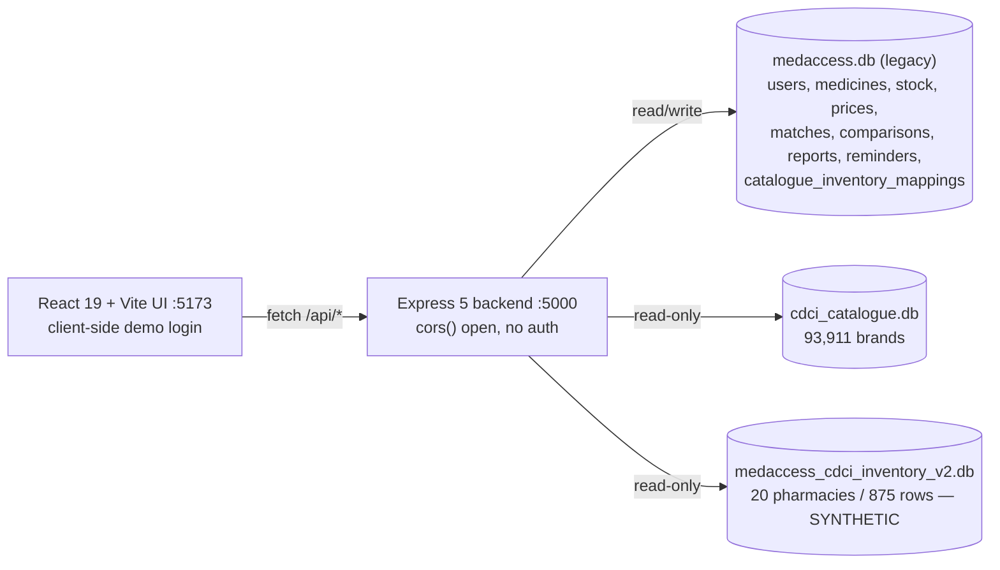
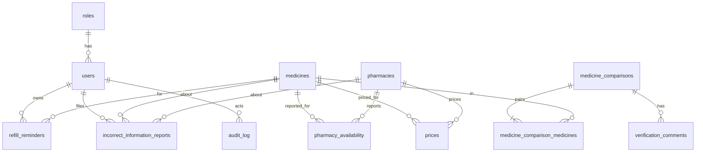

# MEDACCESS — COMPLETE PROJECT DOCUMENTATION

## Document control

| Field | Value |
|---|---|
| Project name | MedAccess — Medicine Availability and Price-Comparison Assistant (pharmacist-supervised) |
| Repository / folder | `Software-Project` (git remote `origin`, branch `main`; folder `C:\Users\bhuva\Downloads\software project\Software-Project`) `[Source: .git/config, docs/README.md]` |
| Document version | 1.1 (2026-10-20: added CDCI Stage 2 and synthetic-inventory packages) |
| Generated | 2026-10-19; revised 2026-10-20 |
| Sources inspected | Project docs (SRS, requirements analysis, feasibility, 14 elicitation docs), 7 StarUML `.mdj` sets, **two supplied zip packages** (Stage 2 app + CDCI + inventory databases; synthetic-inventory starter), the generated `app/` prototype. Details: §29. |
| Development stage | Analysis/design complete (SRS, UML set). **A Stage 2 implementation exists** (Express + React + three SQLite databases, CDCI catalogue + synthetic Inventory V2 integrated; see §9.5, §23.2). A separate, independent prototype `app/` was generated on 2026-10-19 before those packages arrived. Neither has been reviewed by the project team against the SRS. |
| Verification status | SRS/UML contents: **extracted directly from the files** (docx text and `.mdj` JSON). Prototype: **8 automated API tests executed and passing**; UI exercised manually in a browser for patient, pharmacist and administrator roles only. |
| Known limitations of this documentation | Conversation history is still unavailable. The CDCI zip's CSV input (`cdci_catalogue.csv`) and the original CDCI release files are not in the packages. The Stage 2 frontend (`App.jsx`, 2,865 lines) was skimmed (endpoints, roles, demo-login) rather than read line by line. No Stage 2 tests exist and none were run (the app was not started). See §1.3 and §30. |

### Status labels used

**Confirmed** (directly in a source) · **Implemented** (in the `app/` prototype and tested) · **Partially implemented** · **Planned** · **Proposed** (my recommendation, not approved) · **Unverified** · **Conflicting**.

### Table of contents

1. Executive Overview · 2. Project Origin and Evolution · 3. Problem, Motivation, Objectives · 4. Scope · 5. Actors and Permissions · 6. SRS · 7. Use-Case Catalogue · 8. UML Documentation · 9. Architecture · 10. Technology · 11. CDCI · 12. Inventory V2 and Database · 13. Data Model · 14. API · 15. Workflows · 16. Frontend · 17. Security · 18. Data Quality · 19. Audit · 20. Testing · 21. Setup · 22. Deployment · 23. Code Inventory · 24. Traceability · 25. Risks · 26. Open Questions · 27. Status and Next Steps · 28. Glossary · 29. Source Catalogue · 30. Completeness Audit

---

## 1. Executive Overview

### 1.1 Summary

MedAccess is a **pharmacist-supervised medicine information and availability assistant**. It lets users search a medicine catalogue, see which participating pharmacies *report* stock, compare *indicative* prices, see *potential* matching products, and request a pharmacist's verification of a comparison. It also supports incorrect-information reports, refill reminders, pharmacy stock/price maintenance and administration with an audit trail. `[Source: docs/MedAccess_SRS.docx §1.2]`

It is **not** an online pharmacy, diagnostic system, prescribing system, delivery service or autonomous substitution system. `[Source: SRS §1.2, §2.3]`

### 1.2 Technical overview

- **Problem solved:** users must phone several pharmacies to find a medicine, cannot easily compare prices on a like-for-like basis, don't know how fresh stock data is, and risk unsafe substitution if cheaper alternatives are shown without professional review. `[Source: docs/MedAccess_Feasibility_and_Literature_Review.docx §2]`
- **Intended users:** Patient, Caregiver, Pharmacist, Pharmacy Staff, Administrator, Doctor/Healthcare Professional (six UML actors); Clinic/Health Centre is an additional *stakeholder* in the SRS but not a UML actor. `[Source: SRS §3; MedAccess_UseCase_Diagram.mdj]`
- **Key distinctions** (core safety design):
  | Concept | Meaning |
  |---|---|
  | Medicine information | Structured catalogue attributes (ingredient, strength, form, pack size, manufacturer) |
  | Potential match | System-identified product sharing recorded attributes; **informational only** (BR-01) |
  | Pharmacist-verified comparison | A match explicitly verified by an authorised pharmacist (BR-02, FR-26) |
  | Pharmacy availability | *Reported* stock state (Available / Low Stock / Unavailable) with time (BR-05) |
  | Indicative price | Reported price for comparison; not a guaranteed price (SRS §1.4) |
- **Pharmacist verification workflow:** potential match → pending pharmacist review → pharmacist-verified or rejected (STD-02, STD-03, AD-03, SD-03).
- **Architecture constraint (UML):** three layers — Presentation (web UI, no authoritative business rules and no DB access), Application (ten components), Data (one database) `[Source: MedAccess_Architecture_Diagram.mdj]`. The SRS deliberately does **not** fix the technology stack (SRS §2.4, §5.2).
- **Relationship with CDCI and Inventory V2 (Confirmed from the Stage 2 package):** CDCI (*NRCeS Common Drug Codes for India*) is a read-only reference catalogue (93,911 brands) that supplies identifiers and names only. Inventory V2 is a **synthetic** read-only SQLite dataset (20 fictional pharmacies, 875 rows, 120 CDCI products) keyed by CDCI product identifier. Neither is live pharmacy data. See §11 and §12.

### 1.3 What was and was not inspected

| Inspected | Not available |
|---|---|
| 3 core docx documents; 7 questionnaires; 7 simulated response overviews; 7 `.mdj` UML model files (use case, ER, state, architecture, sequence SD-01..10, activity AD-01..10); 7 READMEs | Any conversation history (earlier chats, decisions, replaced code) |
| **`MedAccess_CDCI_Integration_Stage2_V2_COMPLETE.zip`** (46 non-docs files): Express backend (9 route files, `init.js`, 3 DB connectors), React frontend, 5 SQLite databases (read-only), generator script, SQL schema, 6 README/notes files; its `docs/` copy is a partial duplicate of the original documents | The CDCI export CSV used to generate V2 (`cdci_catalogue.csv`); the original CDCI release files and licence text; the NRCeS publisher's documentation |
| **`MedAccess_Synthetic_Inventory_Starter_COMPLETE.zip`** (8 files): v1 and v2 generators, schema, `ARCHITECTURE.md`, 3 READMEs, starter DB | Exported PNG/PDF diagrams |
| Prototype `app/` (generated by this assistant; **94/94 tests pass** after the CDCI/V2 port, attribute parsing, match finder, brand re-key, catalogue overlay, restricted-medicine exclusion, pack-size overlay, search filters, the bulk pack-size import, the server and UI modularisation and the browser smoke tests) | Tests for the Stage 2 app (none exist); a running instance of the Stage 2 app (not started) |

### 1.4 The two codebases (read this first)

| | **Stage 2 app** (supplied by the project owner) | **`app/` prototype** (generated by this assistant, 2026-10-19) |
|---|---|---|
| Location | inside `MedAccess_CDCI_Integration_Stage2_V2_COMPLETE.zip` | `Software-Project/app/` |
| Stack | Express 5 + `better-sqlite3` (backend, port 5000); React 19 + Vite (frontend, port 5173) | Node ≥ 22 built-ins only (`node:http`, `node:sqlite`); vanilla JS |
| Data | CDCI catalogue + Inventory V2 + legacy `medaccess.db` | its own synthetic SQLite schema |
| CDCI / V2 | **Integrated** (read-only) | **Integrated 2026-10-20** (read-only, server-side auth; §12.7) |
| Server-side auth | **None** (client-side demo login) | Scrypt + signed tokens, RBAC on every route |
| Audit log, user/role mgmt, catalogue mgmt, admin reports | **Absent** | Present |
| Tests | none | 8 API tests |

**Decision recorded 2026-10-20 (project owner): `app/` is the main codebase.** CDCI search and V2 demo inventory were ported into it (§12.7); the Stage 2 app is retained as reference only and is not being developed further. Q-A is closed.

---

## 2. Project Origin and Historical Evolution

### 2.1 What can be reconstructed

**Conversation history is still not available.** The chronology below comes from the documents' structure, the READMEs inside the two zips (which narrate the staged integration), file timestamps inside the zips, database metadata and git metadata. Dates not stated by any source say "date unavailable".

| Date / period | Event | Decision or change | Evidence | Current relevance |
|---|---|---|---|---|
| Date unavailable | Feasibility study and literature review | Proposes pharmacist-supervised information system; 8-week academic prototype; limited non-controlled catalogue; manual pharmacy data | Feasibility doc §3, §7 | Defines scope philosophy |
| Date unavailable | Questionnaires for 7 stakeholder groups; **AI-simulated** responses | Elicitation inputs; responses are explicitly *not* real findings | `docs/requirements-elicitation/README.md`; response docs header "SIMULATED DATA" | Must not be cited as real survey evidence |
| Date unavailable | Requirements Analysis v1.0 | 12 stakeholder needs SN-01..12, **24 FRs (numbered FR-01..FR-24)**, 13 NFRs, 10 safety constraints SC-01..10, conflict register | Requirements Analysis doc | **Superseded numbering** (see §6.0) |
| Date unavailable | SRS | Re-baselined to **39 FRs, 18 NFRs, 10 BRs**; formal traceability to SN-01..12 | SRS Appendix A | **Authoritative requirements** |
| Date unavailable | Use-case diagram | 6 actors, 21 use cases | UseCase `.mdj` | Authoritative for actor↔UC links |
| Date unavailable | Activity diagrams AD-01..AD-10 | One per major workflow | `activity-diagrams/*.mdj` | Workflow detail |
| Date unavailable | Sequence diagrams SD-01..SD-10 | Object interactions per workflow | Sequence `.mdj` | Interaction detail |
| Date unavailable | State diagrams STD-01..STD-06 | Lifecycle of account, match, comparison, report, reminder, availability | State `.mdj` | Status values |
| Date unavailable | ER diagram ER-01, architecture diagram | 14 entities; 3-layer component view | ER/Architecture `.mdj` | Data model, structure |
| Git history | One packed commit set on `main`, with `origin/HEAD` | Documents imported into repo | `.git/logs/HEAD` (single entry) | Repo contains documents only |
| 2026-09-14 | Synthetic-inventory generator seed and anchor date (`seed=20260914`, anchor `2026-09-14T12:00:00Z`) | Fixed the reproducible demo dataset | starter READMEs; `dataset_metadata` | Dataset timestamps are relative to this date |
| Date unavailable (before V1) | **Starter**: schema + generator v1.0 for a *separate* synthetic inventory DB | Decision: inventory is separate from the old `medaccess.db`; CDCI is the primary catalogue; synthetic rows labelled demo | `ARCHITECTURE.md` | Target architecture |
| Date unavailable | **CDCI initial step**: read-only `cdci_catalogue.db` + `/api/catalogue` | Safe additive step; legacy routes untouched | `CATALOGUE_INTEGRATION_NOTES.md` | Implemented |
| Date unavailable | **Frontend update**: patient search uses `/api/catalogue` | Catalogue results shown as informational; legacy numeric `medicine_id`s kept for stock/price/report/reminder flows | `README_CDCI_FRONTEND_UPDATE.md` | Implemented |
| 2026-10-14 (row timestamp) | **Stage 2 mapping**: `catalogue_inventory_mappings`, manual link brand→medicine_id | "No guessed links"; test mapping row created 2026-10-14 18:52 | `README_CDCI_STAGE2_MAPPING.md`; `medaccess.db` | Implemented; 1 test row remains |
| Date unavailable | **V1 inventory** from CDCI CSV: 700 rows, 694 products, 1–2 pharmacies each | Too sparse for cross-pharmacy comparison | `medaccess_cdci_inventory.db`, `README_V2_SHARED_PRODUCTS.md` | Kept as rollback |
| Date unavailable (zip entries stamped 2026-10-17) | **V2 inventory**: shared-products generator, 875 rows, 120 products × 5–10 pharmacies; backend switched to V2 | Enables price/availability comparison per product | `README_V2_INTEGRATED.md`; zip timestamps 2026-10-17 05:03 | **Current inventory source** |
| 2026-10-17 | Both zips packaged | Replacement packages: "COMPLETE" folders | zip entry timestamps | — |
| 2026-10-19 | Independent prototype `app/` generated (before the zips were supplied) | Node/SQLite app in `app/` built from the above | This session | **Proposed baseline**, unreviewed |

### 2.2 Historical vs current authority

Intermediate revisions explicitly named in the sources: *Stage 2 inventory-integrated* → *V2 shared-products* (inventory V1 kept as rollback); Backend dependency note: `better-sqlite3` pinned to `^12.x` because "the previous Windows setup installed the 12.x line to avoid the Node 24 / native-build failure encountered with 13.0.3" (`README_CDCI_STAGE2_MAPPING.md`).


The **SRS** is the current authoritative requirements statement; the Requirements Analysis is its predecessor. The UML set is the authoritative design. The Stage 2 code and databases (§9.5, §23.2) are the earliest *implementation* artefacts; they were checked against the SRS in §24.2 and the UML in §8.7, and fall short of both in several areas. Discarded designs and replaced files that are not in the zips cannot be recovered.

---

## 3. Problem Statement, Motivation and Objectives

### 3.1 Problem statement
Patients and caregivers struggle to (a) find a prescribed medicine nearby, (b) compare branded and generic prices, (c) tell whether two products share ingredient and strength, (d) know whether stock data is current, (e) judge whether a cheaper alternative is appropriate, and (f) remember refills. An unreviewed cheaper alternative is a patient-safety risk. `[Source: Feasibility §2]`

### 3.2 Objectives `[Source: Feasibility §4]`
Reduce time to locate a medicine · consistent price comparison · visibility of pharmacy availability · discover potential lower-cost options **without autonomous substitution** · pharmacist oversight · privacy-aware handling of health data · evaluate with usability and quality measures.

### 3.3 Objective classes
| Class | Objective | Source |
|---|---|---|
| Functional | Search, availability, pricing, matching, verification, reporting, reminders, admin, audit | SRS §4 |
| Technical | Modular structure (NFR-18); mobile-friendly UI (NFR-09) | SRS §6 |
| Data quality | Source + timestamp on stock/price; never present stale data as current (NFR-13, NFR-14) | SRS §6.4 |
| Accessibility/usability | Plain language; distinguishable verification states; minimal data entry for pharmacy users (NFR-10..12) | SRS §6.3 |
| Security/privacy | RBAC, authentication, audit, data minimisation, synthetic data (NFR-01..08) | SRS §6.1–6.2 |

### 3.4 Success criteria and acceptance
The SRS defines a *verification approach*, not numeric pass/fail thresholds (SRS §12). Examples: "Authorized pharmacist can verify; unauthorized user cannot"; "System does not present a potential match as an automatic substitution." The Feasibility study sets an 8-week delivery plan (§7.5) and a pilot of one clinic, 2–3 pharmacies and possibly one Jan Aushadhi Kendra (§7.2).

### 3.5 Assumptions and constraints (SRS §2.6, §9)
*Confirmed:* academic prototype; synthetic data for prescription-related testing; controlled/high-risk medicines excluded; no live commercial pharmacy integration; no unverified scraping; manual pharmacy data entry; stock/price may not be real-time; pharmacist verification is a human workflow; test accounts per role will be provided; real integrations need separate analysis.
*Unverified:* eight-week schedule actually applying today; pilot sites actually secured.

---

## 4. Scope and Boundaries

### 4.1 In scope (Must Have, SRS §10)
Search; medicine details; pharmacy listing; availability; timestamps; indicative price comparison; potential matching; verification states; pharmacist verification; stock/price updates; reporting; refill reminders; role-based access; catalogue management; audit logging; safety messaging.

### 4.2 Explicit exclusions and their implications

| Exclusion (source) | UI implication | Backend / API implication |
|---|---|---|
| Diagnosis, prescribing, dosage change, treatment advice (BR-06) | No symptom input, no dose fields; "information only" banner | No endpoints taking symptoms/doses |
| Automatic substitution (BR-01, SC-01) | Matches labelled "Informational match — not verified"; safety message (FR-27) | Match endpoint returns status; verification only via explicit pharmacist endpoint |
| Online sales, payments, delivery (BR-08) | No cart/checkout | No payment/order tables |
| Controlled/restricted medicines (BR-07) | Catalogue form notice | Catalogue validation must reject; prototype uses a name blocklist (**Proposed** — a real controlled-substance list is needed) |
| Live commercial pharmacy integration, scraping (BR-09) | "Synthetic data" banner | No outbound integrations |
| Advanced AI/OCR (SRS §10 Won't Have) | — | — |
| Real patient data (BR-10, NFR-07) | No prescription upload | Seed data synthetic only |

### 4.3 MVP vs later
- **Must:** list above. **Should:** pharmacist comments (FR-24), update attribution, **recurring reminders (FR-34)**, richer freshness/fallback handling. **Could:** expanded reminders, analytics, extra filters, broader catalogue. **Won't (core MVP):** see §4.2 plus national-scale coverage. `[Source: SRS §10]`
- **Note:** UC-17 and UC-11 are marked *optional* in the use-case model; FR-34 and FR-24 use "should".

### 4.4 Future scope (SRS §13)
Verified pharmacy-inventory integration; broader coverage; analytics; more reminder features; clinical integrations (separate regulatory analysis); accessibility and localisation.

---

## 5. Stakeholders, Actors and Permissions

### 5.1 Actors (six UML actors + one stakeholder)

| Actor | Purpose (SRS §3) | Mandatory? | UML associations (from `MedAccess_UseCase_Diagram.mdj`) |
|---|---|---|---|
| Patient | Primary end user | Yes | UC-01..07, 14, 16, 17 |
| Caregiver | Acts on behalf of another person | Yes | UC-01..07, 14, 16, 17 |
| Pharmacist | Verifies comparisons; updates data if authorised | Yes | UC-01, 03, 07..15 (12, 13, 15 "if authorized") |
| Pharmacy Staff | Maintains stock/price; responds to reports | Yes | UC-01, 03, 12, 13, 14, 15 (15 "if authorized") |
| Administrator | Governance | Yes | UC-01, 03, 15, 18..21 |
| Doctor / Healthcare Professional | Safe interpretation, read-only view | **Optional** (UC-01, 03, 07 associations are labelled `optional`) | UC-01, 03, 07 |
| *Clinic / Health Centre* | Pilot/evaluation stakeholder | Stakeholder only — not a UML actor | none `[Source: SRS §3]` |

Relationships between actors: none drawn (no generalisation) in the use-case model.

### 5.2 Role-permission matrix

"UML" = association drawn in the use-case diagram; "Prototype" = what `app/` enforces. A backend authorisation policy is **not finalised** by the sources; the UML does not assign grants beyond associations, so differences are listed in §26.

| Capability | Patient | Caregiver | Pharmacist | Pharmacy Staff | Admin | Doctor |
|---|---|---|---|---|---|---|
| Authenticate (UC-01) | ✔ | ✔ | ✔ | ✔ | ✔ | ✔ (optional) |
| Search medicine (UC-02) | UML ✔ / Prototype ✔ | UML ✔ / ✔ | Prototype ✔ only | Prototype ✔ only | Prototype ✔ only | Prototype ✔ only |
| Medicine details (UC-03) | ✔ | ✔ | ✔ | ✔ | ✔ | ✔ (optional) |
| Availability / prices / compare (UC-04..06) | ✔ | ✔ | Prototype ✔ | Prototype ✔ | Prototype ✔ | ✘ |
| Potential match view (UC-07) | ✔ | ✔ | ✔ | ✘ | ✘ | ✔ (optional) |
| Review/verify/reject/comment (UC-08..11) | ✘ | ✘ | ✔ | ✘ | ✘ | ✘ |
| Update stock/price (UC-12, 13) | ✘ | ✘ | ✔ if authorised | ✔ | ✘ | ✘ |
| Report incorrect info (UC-14) | ✔ | ✔ | ✔ | ✔ | ✘ | ✘ |
| Review/resolve reports (UC-15) | ✘ | ✘ | ✔ if authorised | ✔ if authorised | ✔ | ✘ |
| Reminders (UC-16, 17) | ✔ | ✔ | ✘ | ✘ | ✘ | ✘ |
| Users/roles, catalogue, reports, audit (UC-18..21) | ✘ | ✘ | ✘ | ✘ | ✔ | ✘ |

Authentication is a cross-cutting precondition for all restricted operations even though the diagram does not draw `«include»` relationships (see UC-01 documentation text: "Cross-cutting precondition for restricted operations across all actor roles").

---

## 6. Software Requirements Specification (extracted)

### 6.0 Source conflict: two FR numberings

`[Conflicting]` The **Requirements Analysis** numbers 24 functional requirements FR-01..FR-24 (e.g. its FR-12 = pharmacist verification). The **SRS** renumbers to FR-01..FR-39 (its FR-22 = verify). **This document uses SRS identifiers throughout.** The Requirements Analysis IDs must not be cited without the prefix "RA-".

Mapping hint (derived, **Unverified** — no official crosswalk exists): RA-FR-01/02 ≈ SRS FR-05/06; RA-FR-03 ≈ FR-07; RA-FR-04..07 ≈ FR-10..13; RA-FR-08/09 ≈ FR-15..17; RA-FR-10/11 ≈ FR-20/21; RA-FR-12 ≈ FR-22/23; RA-FR-13 ≈ FR-24; RA-FR-14 ≈ FR-04/26; RA-FR-15/16 ≈ FR-14/18; RA-FR-17 ≈ attribution (SRS §10 "Should"); RA-FR-18 ≈ FR-28; RA-FR-19/20 ≈ FR-32/34; RA-FR-21 ≈ FR-35; RA-FR-22 ≈ FR-36; RA-FR-23 ≈ FR-38; RA-FR-24 ≈ FR-27.

### 6.1 Functional requirements (verbatim from SRS §4; "shall" = mandatory, "should" = prioritised but deferrable)

Columns: **Actors / UCs / Diagrams / Entities / Prototype status / Test**. Prototype status: **I** = Implemented & tested, **P** = Partially implemented.

#### 4.1 Authentication and role management
| ID | Requirement | UCs · Diagrams | Entities | Status | Test |
|---|---|---|---|---|---|
| FR-01 | The system shall authenticate users before granting access to restricted functions. | UC-01 · AD-01, SD-01 | users | I | api.test: FR-01 |
| FR-02 | The system shall associate each authenticated account with an authorized role. | UC-01, 18 · SD-01 | users, roles | I | admin test |
| FR-03 | The system shall restrict role-specific functions and sensitive data according to the user's role. | all · architecture | roles | I | multiple 403 asserts |
| FR-04 | The system shall prevent unauthorized users from performing pharmacist verification or administrative operations. | UC-08..11, 18..21 | — | I | verify/admin tests |

#### 4.2 Medicine search and catalogue
| ID | Requirement | UCs · Diagrams | Entities | Status | Test |
|---|---|---|---|---|---|
| FR-05 | The system shall allow users to search for medicines by medicine name. | UC-02 · AD-02, SD-02 | medicines | I | FR-05/06 |
| FR-06 | The system shall support search using active ingredient, strength and dosage form. | UC-02 | catalogue index | I (separate filters since 2026-10-20, §12.13) | filters.test |
| FR-07 | The system shall display structured medicine information including active ingredient, strength, dosage form, pack size and manufacturer. | UC-03 | medicines | I | UI |
| FR-08 | The system shall allow authorized administrators to manage medicine catalogue records. | UC-19 · AD-09, SD-09 | medicines | I | admin test |
| FR-09 | The system shall validate required medicine fields before accepting a catalogue record. | UC-19 | medicines | I | admin test |

#### 4.3 Pharmacy availability
| ID | Requirement | UCs · Diagrams | Entities | Status | Test |
|---|---|---|---|---|---|
| FR-10 | The system shall display participating pharmacies associated with a searched medicine. | UC-04 · SD-02 | pharmacies, pharmacy_availability | I | UI |
| FR-11 | The system shall display reported availability using available, low stock or unavailable states. | UC-04 · STD-06 | pharmacy_availability | I | stock test |
| FR-12 | The system shall display pharmacy name and location with availability information. | UC-04 | pharmacies | I | UI |
| FR-13 | The system shall display the last-updated or verified time for availability information. | UC-04 | last_updated | I | stock test |
| FR-14 | Authorized pharmacy staff shall be able to update reported medicine availability. | UC-12 · AD-04, SD-04 | pharmacy_availability | I | stock test |

#### 4.4 Price comparison
| ID | Requirement | UCs · Diagrams | Entities | Status | Test |
|---|---|---|---|---|---|
| FR-15 | The system shall display indicative prices for relevant medicine products from participating outlets. | UC-05, 06 | prices | I | UI |
| FR-16 | The system shall display comparison attributes, including active ingredient, strength, dosage form and pack size, where available. | UC-06 | medicines | I | UI |
| FR-17 | The system shall display the pharmacy/source associated with an indicative price. | UC-05 | prices, pharmacies | I | UI |
| FR-18 | Authorized pharmacy staff shall be able to update indicative medicine prices. | UC-13 · AD-05, SD-05 | prices | I | price test |
| FR-19 | The system shall record the date/time associated with a price update. | UC-13 | prices.last_updated | I | price test |

#### 4.5 Matching and pharmacist verification
| ID | Requirement | UCs · Diagrams | Entities | Status | Test |
|---|---|---|---|---|---|
| FR-20 | The system shall identify potential medicine matches using structured medicine attributes. | UC-07 · AD-03, SD-03 | medicines | I (computed) | match test |
| FR-21 | The system shall distinguish informational match, pending pharmacist review and pharmacist-verified comparison states. | UC-07..10 · STD-02, STD-03 | medicine_comparisons | I | match test |
| FR-22 | The system shall allow an authorized pharmacist to verify a potential comparison. | UC-09 | — | I | match test |
| FR-23 | The system shall allow an authorized pharmacist to reject a potential comparison. | UC-10 | — | I | **no explicit reject test** |
| FR-24 | The system should allow a pharmacist to add a review comment. | UC-11 | verification_comments | I | match test (comment via verify) |
| FR-25 | The system shall record the reviewer, timestamp and resulting verification status for a verification action. | UC-09, 10 | verified_by, verification_date | I | match test |
| FR-26 | The system shall not treat a potential match as a pharmacist-verified comparison without an authorized verification action. | UC-09 · BR-02 | — | I | 403/409 asserts |
| FR-27 | The system shall display a safety message stating that a potential match requires confirmation from a doctor or pharmacist before purchase or substitution. | UC-07 | — | I | **UI only, not automated** |

#### 4.6 Reporting incorrect information
| ID | Requirement | UCs · Diagrams | Entities | Status | Test |
|---|---|---|---|---|---|
| FR-28 | The system shall allow users to report potentially incorrect price or availability information. | UC-14 · AD-06, SD-06 | incorrect_information_reports | I | report test |
| FR-29 | A report shall identify the relevant medicine and pharmacy and shall include an issue type and report timestamp. | UC-14 | same (**`medicine_id`/`pharmacy_id` absent from ER-01**) | I | report test |
| FR-30 | The system shall allow authorized users to review and resolve reports. | UC-15 · STD-04 | same | I | report test |
| FR-31 | The system shall record report resolution actions in the audit trail. | UC-15 | audit_log | I | report test |

#### 4.7 Refill reminders
| ID | Requirement | UCs · Diagrams | Entities | Status | Test |
|---|---|---|---|---|---|
| FR-32 | The system shall allow users to create a medicine refill reminder. | UC-16 · AD-07, SD-07 | refill_reminders | I | reminder test |
| FR-33 | A reminder shall contain the relevant medicine and a reminder date/time. | UC-16 | same (**`medicine_id` absent from ER-01**) | I | reminder test |
| FR-34 | The system should support recurring refill reminders. | UC-17 · STD-05 | recurrence | I | reminder test |

#### 4.8 Administration and audit
| ID | Requirement | UCs · Diagrams | Entities | Status | Test |
|---|---|---|---|---|---|
| FR-35 | The system shall allow authorized administrators to manage users and roles. | UC-18 · AD-08, SD-08, STD-01 | users, roles | I | admin test |
| FR-36 | The system shall allow authorized administrators to manage medicine catalogue information. | UC-19 | medicines | I | admin test |
| FR-37 | The system shall provide administrators with access to relevant reports. | UC-20 · AD-10, SD-10 | aggregates | P (report contents undefined in SRS) | admin test (counts only) |
| FR-38 | The system shall maintain an audit record of major account, catalogue, stock, price, verification and report-resolution actions. | UC-21 | audit_log | I | audit asserts |
| FR-39 | Audit records shall contain sufficient information to identify the action, actor and time of the action. | UC-21 | audit_log | I | audit asserts |

### 6.2 Non-functional requirements (verbatim, SRS §6)

| ID | Category | Requirement | Measurable threshold | Prototype |
|---|---|---|---|---|
| NFR-01 | Security | Restricted functions shall require authentication. | none | I |
| NFR-02 | Security | Role-based access shall restrict sensitive operations and data. | none | I |
| NFR-03 | Security | Unauthorized users shall not be able to perform pharmacist verification or administrative operations. | none | I |
| NFR-04 | Security | Security-sensitive and data-changing operations shall be auditable. | none | I (logins, denied access, data changes) |
| NFR-05 | Privacy | Prescription-related and other sensitive health information shall only be accessible to authorized users. | none | N/A — no prescription data stored |
| NFR-06 | Privacy | The prototype shall collect only information necessary for its defined functions. | none | I (name, email, optional contact) |
| NFR-07 | Privacy | Synthetic data shall be used for prescription-related testing unless real-user data is formally authorized. | none | I (all seed data synthetic) |
| NFR-08 | Privacy | The prototype shall not publicly expose prescription images or unnecessary personal health information. | none | I (none stored; login required) |
| NFR-09 | Usability | The system shall provide a mobile-friendly interface. | none | I (responsive; checked at 375 px) |
| NFR-10 | Usability | User-facing medicine and safety information shall use clear, understandable language. | none | P (not user-tested) |
| NFR-11 | Usability | Verification states shall be immediately distinguishable. | none | I (text + colour badges) |
| NFR-12 | Usability | The system shall minimize unnecessary data entry for pharmacy users. | none | P |
| NFR-13 | Reliability | Stock and price records shall display source and last-updated time. | none | I ("source" = pharmacy + updater name) |
| NFR-14 | Reliability | The system shall not represent stale or unavailable information as confirmed current information. | "stale" undefined | P (7-day threshold is a **prototype choice**) |
| NFR-15 | Reliability | Required medicine catalogue fields shall be validated. | none | I |
| NFR-16 | Reliability | Important data changes shall be traceable through audit records. | none | I |
| NFR-17 | Performance | Core search and result-display operations should respond quickly enough for normal interactive use. | **Explicitly not numeric** — "established during prototype testing" | Unmeasured |
| NFR-18 | Maintainability | The prototype should use a modular structure so catalogue, pharmacy, verification, user, reminder, reporting and audit functionality can be maintained independently. | none | I (one module per component under `server/routes/`; see §9.2 and §12.15) |

No numerical performance targets are invented.

### 6.3 Business rules (SRS §8)

| ID | Rule | Enforcement layer in prototype | Test implication |
|---|---|---|---|
| BR-01 | A potential medicine match is informational and is not automatically a substitution recommendation. | UI labels + safety notice | Inspection; assert label on matches |
| BR-02 | Only authorized pharmacists may mark a comparison as pharmacist-verified. | `route(...,['Pharmacist'])` on `/verify` | 403 for patient (tested) |
| BR-03 | A lower price alone shall not establish medicine suitability. | Safety notice on Compare/Matches tabs | Inspection |
| BR-04 | Comparisons shall expose relevant attributes and pack size. | Compare table shows ingredient/strength/form/pack/per-unit | Inspection |
| BR-05 | Availability is reported data and shall carry a timestamp/source. | `last_updated`, `updated_by` | Stock test |
| BR-06 | Diagnosis, prescribing, dosage changes and treatment recommendations are outside system responsibility. | No such features; banner | Inspection |
| BR-07 | Controlled/narcotic/psychotropic/high-risk/restricted medicines are outside the MVP. | Name blocklist in catalogue validation (**Proposed**) | Tramadol rejected (tested) |
| BR-08 | Online sales, payments and home delivery are outside the MVP. | Absence of features | — |
| BR-09 | Direct live commercial pharmacy integration and unverified scraping are outside the core prototype. | Absence; "synthetic" banner | — |
| BR-10 | Real patient data shall not be used without appropriate authorization. | Synthetic seed; no prescription entity | — |

The Requirements Analysis lists additional constraints SC-01..SC-10 that map to these BRs, and conflict resolutions C-01 (cheap alternatives vs safety → label and require verification) and C-02 (fresh data vs pharmacy workload → simple manual updates, timestamps, stale-data transparency). `[Source: Requirements Analysis §7–§8]`

### 6.4 Stakeholder needs and traceability (SRS §11)

| Need | Description | SRS requirements | Stakeholders |
|---|---|---|---|
| SN-01 | Fast medicine search | FR-05–07 | Patient, Caregiver |
| SN-02 | Participating pharmacy availability | FR-10–14 | Patient, Caregiver, Pharmacy |
| SN-03 | Comparable indicative prices | FR-15–19 | Patient, Caregiver, Pharmacy |
| SN-04 | Freshness information | FR-13, FR-19, NFR-13–14 | Patient, Pharmacy |
| SN-05 | Potential lower-cost matches w/o autonomous substitution | FR-20–27, BR-01–03 | Patient, Pharmacist, Doctor |
| SN-06 | Pharmacist review workflow | FR-21–26 | Pharmacist |
| SN-07 | Simple pharmacy data maintenance | FR-14, FR-18–19, NFR-12 | Pharmacy |
| SN-08 | Administration and governance | FR-35–39 | Administrator |
| SN-09 | Privacy-aware health information | NFR-05–08, FR-03, FR-39 | All |
| SN-10 | Incorrect-information reporting | FR-28–31 | Patient, Caregiver, Pharmacy |
| SN-11 | Refill reminders | FR-32–34 | Patient, Caregiver |
| SN-12 | Clear system boundaries | FR-27, BR-06–09 | All |

### 6.5 Acceptance approach (SRS §12) — and proposed criteria

Existing criteria are *verification approaches with example evidence* (not Given/When/Then). They are reproduced in §20. Where an important requirement lacks a concrete criterion, this document's proposals are labelled **Proposed** in §7 and §20.

---

## 7. Use-Case Catalogue

`[Source: MedAccess_UseCase_Diagram.mdj, model "MedAccess", subsystem "MedAccess System"]` — identifiers and titles below were read from the model (21 `UMLUseCase` elements).

### 7.0 How these specifications were built

The use-case diagram contains **only** the titles, actor associations and a one-line `documentation` note per use case (requirement links, "optional", "if authorized", etc.). There is **no textual use-case specification** in the repository. The flows below are therefore **reconstructed** from the corresponding activity diagram (AD), sequence diagram (SD) and state diagram (STD), which are *Confirmed* sources. Anything not in those sources is marked **[Proposed]**. For brevity, the 30 requested fields are consolidated: *Goal/Description* (G), *Actors* (A), *Trigger* (T), *Preconditions* (Pre), *Postconditions / success guarantee* (Post), *Minimum guarantee on failure* (Fail), *Main flow* (Main), *Alternative / exception flows* (Alt), *Business rules* (BR), *Input / Output* (I/O), *Validation* (V), *Authorization* (Auth), *Reads / writes & entities* (Data), *Security & audit* (Sec), *Requirements & diagrams* (Trace), *API / screen in prototype* (Impl), *Acceptance* (Acc) and *Unresolved questions* (Q). Fields the sources do not define are omitted or labelled.

Common to all restricted use cases — **Pre:** actor authenticated with an Active account (UC-01); **Fail:** no data changed and an error is shown. Acceptance criteria are **[Proposed]** unless stated.

### 7.1 Use-case relationships

- **Actor associations:** listed in §5.1. Labels on associations in the model: `optional` for Doctor→UC-01/03/07; `if authorized` for Pharmacist→UC-12, UC-13, UC-15 and Pharmacy Staff→UC-15 (**the associations of Pharmacy Staff→UC-12/13 and Administrator→UC-15 are unlabelled**).
- **Include / extend:** **none drawn** in the model (no `UMLInclude`/`UMLExtend` elements). Do not infer any from naming.
- **Dependencies:** three `«precedes»` dependencies: **UC-07 → UC-08**, **UC-08 → UC-09**, **UC-08 → UC-10** `[Confirmed: UMLDependency source/target resolved from the .mdj]`.
- **Authentication:** UC-01 is documented in the model as a *cross-cutting precondition for restricted operations across all actor roles*.

### 7.2 Specifications

**UC-01 Authenticate User** — *Confirmed title; Implemented*
- G: Establish an authenticated session and determine the user's role. A: all six actors (Doctor optional). T: user opens login. Pre: account exists.
- Main (AD-01/SD-01): open login → enter username/email + password → submit → validate credentials → [valid] establish session → identify role/permissions → [role identified] provide role-appropriate access.
- Alt/Exc: invalid credentials → display authentication error; role not identified → deny protected access. **[Proposed]** account not Active → deny (STD-01: only *Active* accounts "can authenticate").
- Data: reads users, roles. Sec: failed and successful logins audited **[Proposed — SRS FR-38 doesn't list logins]**; throttling after 5 failures **[Proposed]**.
- Trace: FR-01–04, NFR-01–03 · AD-01, SD-01, STD-01. Impl: `POST /api/auth/login`, `GET /api/auth/me`, `POST /api/auth/logout`; `#/login`.
- Q: authentication mechanism (session vs token), password policy, self-registration — **not specified**.

**UC-02 Search Medicine** — *Implemented*
- G: Find medicines by name or by active ingredient/strength/dosage form. A: Patient, Caregiver (UML). Pre: authenticated.
- Main (AD-02): open search → enter query → submit → validate query → search catalogue → find matches → display matching medicines.
- Alt/Exc: query invalid → ask user to refine; catalogue unavailable → "search unavailable" message; no matches → "no results" message.
- Data: reads medicines (Active only **[Proposed]**). Trace: FR-05, 06 (+09 via the diagram note) · AD-02, SD-02. Impl: `GET /api/medicines?q|ingredient|strength|form`; `#/search`.
- Q: whether other roles may search (prototype allows all; see §26).

**UC-03 View Medicine Details** — *Implemented*
- G: Show structured medicine record. A: Patient, Caregiver, Pharmacist, Pharmacy Staff, Administrator, Doctor (optional).
- Main (AD-02): select medicine → retrieve record → [available] display details. Alt: record unavailable → "details unavailable" message.
- Display: active ingredient, strength, dosage form, pack size, manufacturer (FR-07). Impl: `GET /api/medicines/:id`; `#/medicine/:id`.

**UC-04 View Pharmacy Availability** — *Implemented*
- G: See participating pharmacies and their *reported* stock state. A: Patient, Caregiver (UML).
- Main (SD-02): select medicine → retrieve participating pharmacies → retrieve availability **+ last-updated + source** → display. Data: pharmacy_availability, pharmacies. BR-05.
- Trace: FR-10–14, NFR-13/14 · SD-02, STD-06. Impl: `GET /api/medicines/:id/availability` (stale flag after 7 days **[Proposed threshold]**).

**UC-05 View Indicative Prices** — *Implemented*
- G: See reported prices per pharmacy with last-updated and source (SD-02). A: Patient, Caregiver. Data: prices. Trace: FR-15–19. Impl: `GET /api/medicines/:id/prices`.

**UC-06 Compare Medicine Prices** — *Implemented*
- G: Compare prices across the selected medicine and its attribute-matched alternatives. A: Patient, Caregiver. BR-03, BR-04.
- Main: display each product's ingredient/strength/form/pack size and lowest price; the prototype also shows an *approximate per-unit price* parsed from the pack-size text **[Proposed addition; unit parsing is heuristic]**.
- Impl: `GET /api/medicines/:id/price-comparison`; Compare tab.

**UC-07 View Potential Medicine Match** — *Implemented*
- G: See products sharing recorded attributes, clearly labelled informational. A: Patient, Caregiver, Pharmacist, Doctor (optional). Doc note: "Informational only until verified by a Pharmacist."
- Main (AD-03/SD-03): select medicine → retrieve structured information → validate → [sufficient] match against catalogue → [found] display potential matching product (informational match) with safety message.
- Alt (AD-03): insufficient information → display message; no match → "No matching product found".
- Rule: FR-27 safety message always displayed. Match criterion in prototype: same ingredient, strength and dosage form **[Proposed — consistent with the simulated Pharmacist response; SRS only says "structured medicine attributes"]**. Impl: `GET /api/medicines/:id/matches` (local catalogue) and `GET /api/catalogue/:brandId/matches` (CDCI, §12.9).

**UC-08 Review Medicine Comparison** — *Implemented*
- G: Pharmacist opens a pending comparison and reviews it. A: Pharmacist. Pre: a comparison was submitted for review.
- Main (AD-03): user requests verification → system creates verification request → pharmacist opens request → system displays comparison and relevant medicine information → pharmacist reviews.
- Alt (AD-03): **"Pharmacist Review Available?" = No** → mark verification pending and notify the user that verification is pending. (Prototype: status stays *Pending Review*; no notification.)
- State: STD-03 Created → Pending Review → Under Pharmacist Review. Impl: `GET /api/comparisons`, `POST /api/comparisons/:id/open`, `POST /api/comparisons` (request); `#/verification`.

**UC-09 Verify Medicine Comparison** — *Implemented*
- G: Explicitly confirm a comparison. A: Pharmacist. Doc note: "A potential match must never automatically become verified."
- Main (AD-03): [acceptable] confirm comparison → record pharmacist verification → record verifier identity and timestamp → set status Verified → notify/display verified comparison.
- Post: status Verified, `verified_by`, `verification_date`; STD-03 entry action `recordVerification`. Auth: Pharmacist only (FR-22, BR-02). Impl: `POST /api/comparisons/:id/verify`.

**UC-10 Reject Medicine Comparison** — *Implemented*
- Main (AD-03): [not acceptable] reject comparison → record pharmacist decision → set status Not Verified → notify/display non-verified result. STD-02/03 name this state **Rejected**; AD-03 uses the words "Not Verified" `[Conflicting wording]`. Impl: `POST /api/comparisons/:id/reject`.

**UC-11 Add Verification Comment** — *Implemented (optional)*
- G: Attach a review comment (FR-24, "should"). A: Pharmacist. Data: verification_comments (comment_text, created_at, created_by). Impl: `POST /api/comparisons/:id/comments` or a comment submitted with verify/reject.

**UC-12 Update Medicine Stock** — *Implemented*
- G: Update reported availability for a medicine at a pharmacy. A: Pharmacy Staff; Pharmacist if authorized.
- Main (AD-04/SD-04): initiate → check authorisation → [authorised] select medicine → validate medicine and pharmacy context → enter stock status → validate → record updated stock → record update time/context → confirm. SD-04 adds `recordAuditEntry(actor, action, record, timestamp)`.
- Alt: not authorised → access denied; invalid context → message; invalid stock info → validation error.
- V: status ∈ {Available, Low Stock, Unavailable} (SRS §7.2). Impl: `PUT /api/availability`; `#/inventory`.

**UC-13 Update Medicine Price** — *Implemented*
- Same structure as UC-12 (AD-05/SD-05) with price validation (SRS: "validated as appropriate for the chosen data type"). Prototype rule: positive number ≤ 1,000,000, 2 decimals **[Proposed]**. Impl: `PUT /api/prices`.

**UC-14 Report Incorrect Information** — *Implemented*
- G: Flag possibly wrong price/availability. A: Patient, Caregiver, Pharmacist, Pharmacy Staff.
- Main (AD-06/SD-06): select report option → identify medicine/pharmacy → enter issue type and details → submit → validate → [complete] record report and timestamp → assign reviewable status → make available to authorised review. Alt: incomplete → request required information.
- SD-06 initial status "pendingReview"; STD-04 initial state **Submitted** `[Conflicting wording]`. Issue types in prototype: Incorrect Price / Incorrect Availability / Other **[Proposed — SRS names only "price or availability"]**. Impl: `POST /api/reports`.

**UC-15 Review/Resolve Report** — *Implemented*
- G: Authorised reviewer investigates and resolves/rejects. A: Pharmacist, Pharmacy Staff (if authorized), Administrator.
- Main (AD-06): open pending report → validate reviewer authorisation → display report + underlying info → investigate → [sufficient evidence] determine resolution → record resolution/status → record reviewer identity and timestamp → update status. Alt: unauthorised → deny; insufficient evidence → mark for further review / leave unresolved.
- STD-04: Submitted → Under Review → Investigating → Resolved | Rejected; Resolved entry action `createAuditEntry` (FR-31).
- Rule from simulated Pharmacist response: reports should be routed to the responsible party "rather than silently changing data" → prototype never edits stock/price on resolution **[Proposed interpretation]**. Impl: `GET /api/reports`, `POST /api/reports/:id/{review|investigate|resolve|reject}`.

**UC-16 Create Refill Reminder** — *Implemented*
- Main (AD-07/SD-07): select create → select/enter medicine → specify date/time → validate → [valid] store → schedule → confirmation. Alt: invalid → request correction. A: Patient, Caregiver. Impl: `POST /api/reminders`; `#/reminders`.
- Q: delivery mechanism for reminders — not specified (prototype shows "Due now" in-app only).

**UC-17 Manage Recurring Refill Reminder** — *Partially implemented (optional)*
- Main (AD-07): configure recurring? → enable → select pattern → validate → store recurring schedule → schedule future occurrences. SD-07 also shows `modifyReminder` and `cancelReminder`. STD-05 includes `reschedule [recurring]`.
- Prototype: recurrence None/Daily/Weekly/Monthly, "Mark done" reschedules, cancel supported; **modify (SD-07) is not implemented.**

**UC-18 Manage Users and Roles** — *Implemented*
- Main (AD-08/SD-08): open user management → select action → enter data → validate administrator authorisation → display records → validate → store → record administrative action for audit → continue? Alt: unauthorised → deny; invalid → validation error.
- STD-01: Created →(activate) Active ⇄(inactivate/reactivate) Inactive; Active →(deactivate) Deactivated (no Inactive→Deactivated edge). Impl: `/api/admin/users…`; `#/admin/users`.
- Q: difference between **Inactive** and **Deactivated** is described only as "normal access not currently enabled" vs "no longer active".

**UC-19 Manage Medicine Catalogue** — *Implemented as an overlay (2026-10-20)*
- Main (AD-09/SD-09): open → authorise → display records → create/select → enter/update → validate → check duplicates/inconsistency → store → audit → continue. Alt: duplicate/inconsistent → request correction/review.
- Prototype: since the CDCI catalogue is read-only, administrators **hide**, **annotate** and **add** brands (§12.11) instead of editing CDCI records; added brands are editable, CDCI ones are not. Validation (FR-09): all six attributes required; restricted-name screen; duplicate check. Impl: `/api/admin/catalogue…`; `#/admin/catalogue`.

**UC-20 View Administrative Reports** — *Partially implemented*
- Main (AD-10/SD-10): open reporting → authorise → choose function → select report → retrieve/generate → [data available] display. Alt: no data/failure → message.
- **Report types are not defined anywhere in the sources** (SRS says "relevant reports"). The prototype shows counts by role/status/comparison/report/reminder, stale-record counts and catalogue size **[Proposed]**.

**UC-21 View Audit Log** — *Implemented*
- Main (AD-10/SD-10): select audit log → retrieve authorised records → [available] display. Fields: actor, action, affected record, timestamp, result (SD-10, ER AUDIT_LOG_ENTRY). Impl: `GET /api/admin/audit`. Prototype adds a `details` JSON (before/after) **[Proposed, supports NFR-16]**.

---

## 8. UML and Diagram Documentation

### 8.1 Master diagram inventory

All sources are StarUML `.mdj` JSON models (no PNG/PDF exports exist). Diagram numbering: **AD-01..AD-10**, **SD-01..SD-10**, **STD-01..STD-06**, **ER-01**, plus one use-case diagram and one architecture diagram.

| Diagram ID | Title | Type | File | Related UCs | Status |
|---|---|---|---|---|---|
| — | MedAccess – Use Case Diagram | Use case | `docs/uml-diagrams/MedAccess_UseCase_Diagram.mdj` | UC-01..21 | Confirmed |
| — | MedAccess System Architecture Diagram | Component | `docs/uml-diagrams/MedAccess_Architecture_Diagram.mdj` | all | Confirmed |
| ER-01 | MedAccess Entity-Relationship Diagram | ER (UML class notation) | `docs/uml-diagrams/MedAccess_ER_Diagram.mdj` | all | Confirmed |
| STD-01..06 | State machines | State | `docs/uml-diagrams/MedAccess State Diagrams.mdj` | UC-18, 07–10, 14–15, 16–17, 12 | Confirmed |
| SD-01..10 | Sequence diagrams | Sequence | `docs/uml-diagrams/MedAccess_Sequence_Diagrams_SD01-SD10.mdj` (≈1 MB) | see below | Confirmed |
| AD-01 | Authenticate User | Activity | `activity-diagrams/AD-01_Authenticate_User.mdj` | UC-01 | Confirmed |
| AD-02 | Medicine Search and Details | Activity | `AD-02_Medicine_Search_and_Details.mdj` | UC-02, 03 | Confirmed |
| AD-03 | Medicine Matching and Pharmacist Verification | Activity | `AD-03_…mdj` | UC-07–11 | Confirmed |
| AD-04 | Update Medicine Stock | Activity | `AD-04_…mdj` | UC-12 | Confirmed |
| AD-05 | Update Medicine Price | Activity | `AD-05_…mdj` | UC-13 | Confirmed |
| AD-06 | Report and Resolve Incorrect Information | Activity | `AD-06_…mdj` | UC-14, 15 | Confirmed |
| AD-07 | Refill Reminders | Activity | `AD-07_…mdj` | UC-16, 17 | Confirmed |
| AD-08 | User and Role Management | Activity | `AD-08_…mdj` | UC-18 | Confirmed |
| AD-09 | Medicine Catalogue Management | Activity | `AD-09_…mdj` | UC-19 | Confirmed |
| AD-10 | Administrative Reporting and Audit | Activity | `AD-10_…mdj` | UC-20, 21 | Confirmed |

No class diagram (other than the ER-in-class-notation), deployment diagram, or data-flow diagram exists. **No diagram covers UC-04/05/06 as an activity diagram** (they appear in SD-02 only).

### 8.2 Activity diagrams (swimlanes, nodes, guards)

Extracted from `UMLAction`, `UMLDecisionNode`, `UMLActivityPartition` and guarded `UMLControlFlow` elements. Fork/join and merge nodes: none found by my extraction (only decision nodes were observed). Guards are `Yes`/`No`.

| AD | Swimlanes | Decision nodes (all guards Yes/No) | Terminal behaviours |
|---|---|---|---|
| AD-01 | User; MedAccess System | Credentials Valid?; Role Identified? | Authentication Successful; Display Authentication Error; Deny Protected Access |
| AD-02 | Patient/Caregiver; MedAccess System | Query Valid?; Catalogue Available?; Matches Found?; Record Available? | Display Medicine Details / unavailable / no results / refine query |
| AD-03 | User; MedAccess System; Pharmacist | Sufficient Information for Matching?; Matching Product Found?; Request Pharmacist Verification?; Pharmacist Review Available?; Comparison Acceptable for Verification? | Unverified comparison shown; Verified; Not Verified; Pending |
| AD-04 | Pharmacist/Pharmacy Staff; MedAccess System | Authorised to Update Stock?; Medicine and Pharmacy Context Valid?; Stock Information Valid? | Confirmation / denied / invalid context / validation error |
| AD-05 | same | Authorised to Update Price?; context valid?; Price Information Valid? | same |
| AD-06 | Reporter; MedAccess System; Authorized Reviewer | Report Complete?; Authorized?; Sufficient Evidence to Resolve? | Resolved/tracked; unresolved; denied |
| AD-07 | Patient/Caregiver; MedAccess System | Reminder Information Valid?; Configure Recurring Reminder?; Recurrence Valid? | Reminder confirmation |
| AD-08 | Administrator; MedAccess System | Administrator Authorized?; Action Valid?; Continue Managing Users? | loop until done |
| AD-09 | same | Administrator Authorized?; Catalogue Data Valid?; Duplicate/Inconsistent Record?; Continue Catalogue Management? | loop until done |
| AD-10 | same | Administrator authorized?; Administrative function?; Report data available / generated successfully?; Audit records available? | display report or audit records |

Action sequences for each are given in the corresponding use-case specification in §7.2. Full action lists are in the `.mdj` files.

### 8.3 Sequence diagrams (lifelines and messages)

`[Source: MedAccess_Sequence_Diagrams_SD01-SD10.mdj]` — messages in order.

| SD | Lifelines | Key messages |
|---|---|---|
| SD-01 Authenticate User | User, MedAccess, UserAccount, Role | authenticateUser(credentials) → retrieveAccount → accountRecord, accountStatus → retrieveAuthorizedRole() → role → authenticationResult(success, role) |
| SD-02 Availability & Price Comparison | User, MedAccess, Medicine, Pharmacy, PharmacyAvailability, Price | searchMedicine → matchingMedicines; selectMedicine; retrieveMedicineDetails; retrieveParticipatingPharmacies; retrieveAvailability → availability + lastUpdated + source; retrieveIndicativePrices → price + lastUpdated + source |
| SD-03 Matching & Verification | User, MedAccess, Medicine, PotentialMedicineMatch, MedicineComparison, Pharmacist | retrieveStructuredAttributes; generatePotentialMatch; **createComparison(potentialMatch) [status = pendingPharmacistReview]**; reply with safetyMessage; submitForReview; openComparison; verify/rejectComparison; recordVerificationOutcome(reviewer, timestamp, status); addReviewComment |
| SD-04 Update Stock | Pharmacy Staff, MedAccess, Medicine, Pharmacy, PharmacyAvailability, AuditLogEntry | authenticateUser; select medicine/pharmacy; updateAvailability(state); validateAvailability; updateAvailabilityRecord(state, updater, timestamp); recordAuditEntry |
| SD-05 Update Price | … Price … | same with updatePrice(amount), validatePrice, updatePriceRecord |
| SD-06 Report & Resolve | User, MedAccess, Medicine, Pharmacy, IncorrectInformationReport, Authorized Reviewer, AuditLogEntry | submitReport(issueType); addComment; createReport(medicine, pharmacy, issueType, timestamp) → reportId, status = pendingReview; resolveReport(outcome); recordResolution(action, reviewer, timestamp); recordAuditEntry |
| SD-07 Reminders | User, MedAccess, Medicine, RefillReminder | createReminder; validateReminder; storeReminder; specifyRecurrence; storeRecurrenceConfig; modifyReminder; cancelReminder → updateReminderStatus(cancelled) |
| SD-08 User & Role Mgmt | Administrator, MedAccess, User, Role, AuditLogEntry | verifyAdministratorAuthorization; updateUserRole(userId, role); validateChange; applyChange; recordAuditEntry |
| SD-09 Catalogue Mgmt | Administrator, MedAccess, Medicine, AuditLogEntry | addMedicine; validateMedicineData; createMedicineRecord; modifyCatalogueInformation; saveUpdate; recordAuditEntry (create and update) |
| SD-10 Admin Reporting & Audit | Administrator, MedAccess, Medicine, AuditLogEntry | requestReport(reportType); retrieveRelevantRecords; retrieveAuditEntries; reply auditEntries (actor, action, affectedRecord, timestamp, result) |

Activation bars, combined fragments (alt/loop) and guard conditions were **not extracted** by my script (only messages). `[Unverified]` — open the file in StarUML for fragment-level detail.

### 8.4 State diagrams `[Source: MedAccess State Diagrams.mdj]`

| STD | States | Transitions (event [guard]) |
|---|---|---|
| STD-01 User Account | Created, Active, Inactive, Deactivated | (initial) →createAccount→ Created; Created →activate [authorized administrator]→ Active; Active →deactivate [authorized administrator]→ Deactivated; Active →inactivate→ Inactive; Inactive →reactivate→ Active. *No edge from Inactive to Deactivated.* |
| STD-02 Potential Medicine Match | Potential Match, Pending Pharmacist Review, Pharmacist-Verified, Rejected | →identifyPotentialMatch→ Potential Match →submitForReview→ Pending Pharmacist Review →verify [authorized pharmacist]→ Pharmacist-Verified; →reject [authorized pharmacist]→ Rejected |
| STD-03 Medicine Comparison | Created, Pending Review, Under Pharmacist Review, Verified (entry: recordVerification), Rejected | →createComparison→ Created →submitForReview→ Pending Review →pharmacistOpensReview [authorized pharmacist]→ Under Pharmacist Review →verify / reject [authorized pharmacist]→ Verified / Rejected |
| STD-04 Incorrect Information Report | Submitted, Under Review, Investigating, Resolved (entry: createAuditEntry), Rejected | →submitReport→ Submitted →reviewReport [authorized reviewer]→ Under Review →beginInvestigation→ Investigating →resolve / reject [authorized reviewer]→ Resolved / Rejected. *No edge from Under Review directly to Resolved/Rejected.* |
| STD-05 Refill Reminder | Created, Scheduled, Triggered ("only if the prototype models a triggering event"), Completed, Cancelled | →createReminder→ Created →schedule→ Scheduled →trigger [reminder date/time reached]→ Triggered →complete→ Completed; Triggered →reschedule [recurring]→ Scheduled; Scheduled →cancel→ Cancelled. *No cancel edge from Triggered; no complete edge from Scheduled.* |
| STD-06 Pharmacy Availability | Available, Low Stock, Unavailable | →createAvailability→ Available; `updateAvailability` between every ordered pair of the three states (6 transitions) |

### 8.5 Architecture diagram `[Source: MedAccess_Architecture_Diagram.mdj]`

Actors: Regular User; Pharmacist / Pharmacy Staff; Administrator. Packages and components:

| Layer | Component | Responsibility (from model documentation) | UCs |
|---|---|---|---|
| Presentation | MedAccess Web / UI | Login, search, details, comparison, availability, reports, reminders, admin UI. **Must not contain authoritative business rules or access the database directly.** | all |
| Application | Authentication & Authorization | Authenticate, sessions/tokens, role, enforce authorisation | UC-01, 18 |
| | Medicine Catalogue | Search, details, admin maintenance | UC-02, 03, 19 |
| | Pharmacy Availability | Retrieve/update availability; freshness | UC-04, 12 |
| | Price & Comparison | Indicative prices, comparison, comparison records | UC-05, 06, 08 |
| | Medicine Matching & Verification | Potential matches, verify/reject, outcomes/comments | UC-07–11 |
| | Incorrect Information Reporting | Accept and track reports | UC-14, 15 |
| | Refill Reminder | Create/schedule/trigger/manage | UC-16, 17 |
| | User & Role Management | Users, roles, activation | UC-18 |
| | Administrative Reporting | Aggregated operational information | UC-20 |
| | Audit Service | Cross-cutting recording of actor/time/action/result | UC-21 |
| Data | MedAccess Database | Users, roles, catalogue, pharmacies, availability, prices, matches, comparisons, comments, reports, reminders, audit entries | — |

### 8.6 ER diagram (ER-01) — see §13 for the full attribute listing.

### 8.7 Consistency audit (diagrams ↔ diagrams ↔ SRS)

| # | Finding | Sources | Type | Recommendation (not applied) |
|---|---|---|---|---|
| D1 | SRS requires `medicine_id` + `pharmacy_id` on a report (FR-29) and `medicine_id` on a reminder (FR-33); ER-01 `INCORRECT_INFORMATION_REPORT` and `REFILL_REMINDER` have neither | SRS §4.6/4.7 vs ER-01 | Missing attributes | Add FK columns to the ER |
| D2 | SRS Stock/Price Records include *updater*; ER `PHARMACY_AVAILABILITY` and `PRICE` have no `updated_by` | SRS §7.1 vs ER-01 | Missing attributes | Add `updated_by` |
| D3 | FR-25 requires reviewer on verification; ER `MEDICINE_COMPARISON` has only `verification_date` | FR-25 vs ER-01 | Missing attribute | Add `verified_by` |
| D4 | SRS User has "authentication information"; ER `USER` has no password/credential or email | SRS §7.1 vs ER-01 | Missing | Add credential fields |
| D5 | AD-06/SD-06/STD-04 name the reviewer; ER report has no resolver/resolved_at | AD-06 vs ER | Missing | Add |
| D6 | SD-03 creates a comparison already in `pendingPharmacistReview`; STD-02 begins at "Potential Match" and STD-03 at "Created" | SD-03, STD-02, STD-03 | **Conflicting** | Decide whether a comparison row exists before a verification request |
| D7 | AD-03 words the rejected outcome as "Not Verified"; STD-02/03 call it "Rejected" | AD-03, STD | Naming | Standardise on "Rejected" |
| D8 | Report initial status: SD-06 "pendingReview" vs STD-04 "Submitted" | SD-06, STD-04 | Naming | Standardise |
| D9 | STD-01 has both *Inactive* and *Deactivated* without defined business meaning | STD-01 | Unclear | Define (e.g., temporary vs permanent) |
| D10 | STD-05 "Triggered" is conditional; SRS never requires a notification | STD-05, SRS | Unclear | Decide notification mechanism |
| D11 | SD-07 includes *modify reminder*; SRS FR-32–34 and AD-07 do not | SD-07 | Diagram feature not in SRS | Add to SRS or remove from SD |
| D12 | UC-02 is linked only to Patient/Caregiver; UC-03 links to everyone | Use-case model | Possible omission | Decide whether Pharmacy roles can search |
| D13 | Stock/price updates (UC-12/13) lack a visible *authenticate* step in AD-04/05, but SD-04/05 include authenticateUser | AD-04/05 vs SD-04/05 | Inconsistent | Add to ADs or document UC-01 as precondition |
| D14 | No diagram or SRS requirement for **catalogue-management entities** like Pharmacy records or participation status (ER has no `participation_status`; SRS §7.1 lists it) | SRS vs ER | Missing attribute | Add |
| D15 | SRS lists "Clinic / Health Centre" as stakeholder; no actor/UC | SRS §3 vs UC model | Gap (probably intentional) | Confirm |
| D16 | Pharmacist simulated response requests a *request-more-information* verification action; no SRS/UML equivalent | Pharmacist response | Possible missing requirement | Confirm whether wanted |
| D17 | Administrative reports (FR-37, UC-20) have no defined content | SRS, AD-10 | Underspecified | Define report list |
| D18 | `POTENTIAL_MEDICINE_MATCH` entity exists in ER with `match_status`, while STD-02 and STD-03 represent overlapping lifecycles | ER, STD | Redundancy | Decide whether to keep both |
| D19 | No diagram for availability/price *viewing* as activity (UC-04..06) | AD set | Coverage gap | Optional |
| D20 | Requirements without a corresponding diagram: FR-01..04 (AD-01 partial), FR-27 (safety message appears only in SD-03 reply), NFR-* (none) | — | Coverage | — |

### 8.8 Original diagram source

The `.mdj` files are JSON StarUML models and are the authoritative source; they are not reproduced in this document. Open them in StarUML (File → Open). The element listings above were extracted programmatically from `ownedElements`.

---

## 9. Architecture and System Design

### 9.1 Overview

| Element | Confirmed design (UML) | Prototype (`app/`) |
|---|---|---|
| Frontend | MedAccess Web / UI; no business rules, no DB access | Vanilla-JS single-page app, hash routing, in `app/public/` |
| Backend | 10 application components (§8.5) | Node `http` server; all routes in `server/app.js` sectioned by use case |
| Application DB | One "MedAccess Database" | SQLite file via built-in `node:sqlite` (`app/data/medaccess.db`, git-ignored) |
| Authentication | "sessions/tokens" (unspecified) | Scrypt password hashes + HMAC-signed bearer tokens, 8 h |
| External integrations | **None specified** | None |
| Notifications | **Not specified** | None (reminders shown in-app) |
| Logging / audit | Audit Service component | `audit_log` table + `GET /api/admin/audit` |
| Environments | Not specified | Local only |

### 9.2 Layer responsibilities and request flow (`app/`, modular since 2026-10-21)

Request → `http.js` pipeline: static file or `/api/*` → route match → **authenticate** (bearer token → user row; account must be `Active`) → **authorise** (role list per route) → JSON body parse (100 kB cap; 2 MB on the CSV-import routes) → handler (validation, SQL, audit) → JSON response. Errors are sanitised (500 → generic message). UI → `api()` helper → handler.

| Layer / file | Responsibility |
|---|---|
| `server/app.js` (29 lines) | **Composition root**: builds the kernel, registers the component modules (their order is the routing priority), returns the handler (`handler.routes` is exposed for tests) |
| `server/kernel.js` | **Shared context** handed to every module: `db`/`q`/`one`/`run`, `audit`, `userRow`, the route registry (`route`, `routes`), role constants (`ALL`, `READERS`, `ADMIN`), the reference stores (`ref`, `requireRef`), plus the shared helpers below |
| `server/util.js` | `ApiError`, `bad`, `nowIso`, `str`, `isStale`, `STALE_HOURS` |
| `server/brands.js` | Brand model shared by several components: `attributesOf`, pack-size arithmetic (`perUnit`, `packDiff`), `catalogueFilter`, `brandOr404`, `brandSummary` |
| `server/availabilityModel.js` | Seeded availability merged with staff overrides; pharmacy lookup (also used by admin reports) |
| `server/http.js` | The request pipeline: routing, authentication/authorisation, body reader, JSON errors, static files, security headers |
| `server/routes/*.js` | One module per component: `auth` (UC-01), `catalogue` (UC-02/03), `matching` (UC-07..11), `availability` (UC-04/05/12/13), `reports` (UC-14/15), `reminders` (UC-16/17), `adminUsers` (UC-18), `adminCatalogue` (UC-19 incl. overlay, import/export), `adminReports` (UC-20, restricted-list review), `audit` (UC-21) |
| Data access | `db.js` (application schema), `refdata.js` (read-only CDCI + inventory), `restricted.js`, `synonyms.js`, `cdciParse.js`, `csv.js`, `packImport.js` |

**Front end (`app/public/`, ES modules, no build step):**

| File | Responsibility |
|---|---|
| `index.html` → `main.js` | entry: `<script type="module" src="/main.js">`; wires session expiry, the shell and the router |
| `js/dialog.js`, `js/a11y.js` | accessible text dialog (replaces `prompt()`); enhancer that names tables, sets header scope, scroll regions and page titles (§12.17) |
| `js/ui.js` | DOM builder `h()`, formatting (`money`, `when`, `ago`), `toast`, `act`, badges, `field`, `empty`, safety notice, `attrText`, `originBadges` — no state |
| `js/session.js` | the one shared state object (`session.token`, `session.user`) and the `api()` client |
| `js/shell.js` | role-based navigation, header/banner, `setSession`, logout |
| `js/router.js` | hash → page table, login and role enforcement, loading/error states |
| `js/pages/*.js` | one module per page: `login`, `catalogue`, `availabilityPanel` (shared by catalogue and inventory), `verification`, `inventory`, `reports`, `reminders`, `adminUsers`, `adminCatalogue` (overlay + CSV import), `adminReports`, `adminAudit`, `docs` (13–155 lines each) |

Each module is `module.exports = function register(k) { const { … } = k; route(…) }`. There are still no separate controller/service classes — handlers contain their validation and SQL — but the ten components of the architecture diagram now map one-to-one to files (the *Audit Service* is `kernel.audit`, called by every module).

### 9.5 Stage 2 architecture (existing implementation)


Routes mount order (`server.js`): `/api/catalogue`, `/api/demo-inventory`, `/api/medicines`, `/api/matches`, `/api/comparisons`, `/api/stock`, `/api/prices`, `/api/reports`, `/api/reminders`. Layers: no service/model layer — route files contain SQL directly (`better-sqlite3` prepared statements). The architecture diagram's ten components are **not** mirrored (no Authentication & Authorization, User & Role Management, Administrative Reporting or Audit Service component exists in code).

### 9.3 Actual folder structure

```
Software-Project/
├─ README.md, docs/README.md                      (one-line READMEs)
├─ docs/
│  ├─ MedAccess_Feasibility_and_Literature_Review.docx
│  ├─ MedAccess_Requirements_Analysis.docx        (RA numbering FR-01..24)
│  ├─ MedAccess_SRS.docx                          (authoritative; FR-01..39)
│  ├─ requirements-elicitation/{questionnaires,responses}/   (7 + 7 docx; responses SIMULATED)
│  └─ uml-diagrams/
│     ├─ MedAccess_UseCase_Diagram.mdj, MedAccess_ER_Diagram.mdj,
│     │  MedAccess_Architecture_Diagram.mdj, MedAccess State Diagrams.mdj,
│     │  MedAccess_Sequence_Diagrams_SD01-SD10.mdj
│     └─ activity-diagrams/AD-01 … AD-10 (.mdj)
├─ MedAccess_CDCI_Integration_Stage2_V2_COMPLETE.zip   ← Stage 2 app + CDCI + inventory DBs (see §23.2)
├─ MedAccess_Synthetic_Inventory_Starter_COMPLETE.zip  ← generators + starter DB (see §12)
├─ app/                                           ← independent prototype generated 2026-10-19 (see §23.1)
└─ MEDACCESS_COMPLETE_PROJECT_DOCUMENTATION.md    ← this file
```
**No proposed folder structure** exists in the sources.

### 9.4 Architecture decision register

| ID | Decision | Status | Rationale / evidence | Consequence |
|---|---|---|---|---|
| ADR-01 | Three-layer separation (UI / application / data) | **Confirmed** (architecture diagram) | UI must not own business rules or touch DB | Server enforces all rules; UI is untrusted |
| ADR-02 | Technology stack unspecified by SRS | **Confirmed** (SRS §2.4, §5.2) | Left to implementation | Stage 2 chose Express/React/SQLite; `app/` chose Node built-ins |
| ADR-09 | CDCI is the primary reference catalogue; inventory is a separate DB; legacy DB to be retired after cutover | **Confirmed** (starter `ARCHITECTURE.md`) | Avoid coupling to hand-seeded legacy rows | Cutover incomplete |
| ADR-10 | CDCI and inventory DBs opened read-only (`readonly` + `query_only`) | **Implemented** (Stage 2) | Protect reference data | No application writes to inventory |
| ADR-11 | No automatic catalogue→inventory matching; manual mapping only | **Implemented** (Stage 2 mapping notes) | Name similarity ≠ equivalence | Only 1 test mapping exists |
| ADR-12 | Synthetic data labelled in every response (`dataLabel`, `isSynthetic`) | **Implemented** (`demoInventoryRoutes.js`) | BR-09, NFR-07 | UI must always show the label |
| ADR-03 | Single database for all entities | **Confirmed** (UML architecture) vs **Conflicting** in Stage 2 (three DBs) | UML shows one "MedAccess Database"; Stage 2 splits catalogue, inventory and application data | Needs an explicit decision (Q-A, Q-B) |
| ADR-04 | Node.js + built-in SQLite, zero dependencies | **Proposed** | Runs offline with `node` only; no native build tools | Needs Node ≥ 22.13; SQLite is not for multi-writer production |
| ADR-05 | Bearer-token auth (HMAC) | **Proposed** | Simple, stateless | No server-side revocation except account status; tokens vanish on restart unless `MEDACCESS_SECRET` set |
| ADR-06 | Matches computed on demand (ingredient+strength+form) | **Proposed** | Avoids persisting unverified data | `POTENTIAL_MEDICINE_MATCH` table not materialised |
| ADR-07 | Archive instead of delete for catalogue | **Proposed** | Preserves referential integrity with history | — |
| ADR-08 | Staleness threshold 7 days | **Proposed** | NFR-14 needs a threshold | Needs stakeholder confirmation |

---

## 10. Technology Stack and Dependencies

| Item | Value | Status |
|---|---|---|
| Language / runtime | JavaScript (CommonJS), Node.js ≥ 22.13 (tested on v22.18.0) | Prototype |
| Backend framework | None — `node:http` | Prototype |
| Database | SQLite via `node:sqlite` (`DatabaseSync`) — prints an ExperimentalWarning on Node 22 | Prototype |
| Crypto | `node:crypto` scrypt, HMAC-SHA256, `timingSafeEqual` | Prototype |
| Frontend | Vanilla JS, CSS custom properties, light/dark via `prefers-color-scheme` | Prototype |
| Tests | `node:test` + `fetch` | Prototype |
| npm packages | **None.** `package.json` lists no dependencies | — |
| Diagram tool | StarUML (`.mdj` files) | Confirmed |
| Documents | Word `.docx` | Confirmed |
| External APIs | None | — |

### Stage 2 stack (from `package.json` files)

| Package | Version range | Used for | Status |
|---|---|---|---|
| express | ^5.2.1 | HTTP API | required |
| better-sqlite3 | ^12.11.1 (notes say 12.x pinned; 13.0.3 failed to build on Node 24/Windows) | DB driver (3 connections) | required; native build |
| cors | ^2.8.6 | open CORS | required (**unsafe default**, §17.2) |
| nodemon | ^3.1.14 | dev reload | dev |
| react / react-dom | ^19.2.8 | UI | required |
| vite + @vitejs/plugin-react | ^8.3.0 / ^6.1.1 | build/dev server | dev |
| eslint (+ react-hooks, react-refresh) | ^10.10.0 | lint | dev |
| Python 3.9+ (stdlib only) | — | generators | tooling |
Lockfiles `backend/package-lock.json` (57 KB) and `frontend/package-lock.json` (85 KB) are present in the zip (the mapping README says the backend lockfile is "intentionally omitted" — **contradiction**; the file exists). `node_modules` are excluded. Backend `npm test` is the placeholder `echo "Error: no test specified"`.

Concerns (`app/` prototype): `node:sqlite` is experimental in Node 22 (API may change); Node < 22.5 unsupported. No lockfile because no dependencies.

---

## 11. CDCI Integration

**Status: Confirmed from the supplied package** `MedAccess_CDCI_Integration_Stage2_V2_COMPLETE.zip` (inspected 2026-10-20). **No CDCI API specification was supplied** — CDCI is used here as a *local read-only SQLite database*, not as a web API.

### 11.1 What CDCI is, according to the sources
- Expansion: **"NRCeS Common Drug Codes for India"** `[Source: starter sql/schema.sql default value of inventory_items.cdci_source; backend/src/routes/catalogueRoutes.js response field "CDCI Common Drug Codes for India"]`. NRCeS is named in the schema; its expansion and the publisher's licence terms are **not in the package** — `[NOT AVAILABLE IN THE INSPECTED SOURCES — CONFIRMATION REQUIRED]`.
- Role in MedAccess: the **reference medicine terminology/catalogue**. It supplies identifiers and names only. It does **not** supply live stock or retail prices, and does not prove clinical interchangeability `[Source: CATALOGUE_INTEGRATION_NOTES.md, README_V2_INTEGRATED.md]`.
- Provenance: `database/cdci_catalogue.db` "copied from the verified CDCI staging database" `[Source: CATALOGUE_INTEGRATION_NOTES.md]`. How the staging database was built from the original CDCI release files is **not documented** (no import script is in the package).

### 11.2 CDCI database structure (`database/cdci_catalogue.db`, 22.7 MB, opened read-only)

| Object | Rows | Columns |
|---|---|---|
| `brand_master` | 93,911 | Identifier, Brand Name, Product Identifier, Supplier Identifier, Generic Identifier, License Number, License Status, Excipient, last_updated_on |
| `product_master` | 72,284 | Identifier, Product Name |
| `generic_master` | 10,305 | Identifier, Generic Name, Substance Identifier, Route of Administration, Dose Form, Therapeutic Role, Indication, Contra Indication, Interaction with Drugs, Classification of Drugs, Source/ Regulatory, last_updated_on |
| `substance_master` | 3,283 | Identifier, Substance Name, CAS Number, UNII, description, molecular fields, last_updated_on |
| `supplier_master` | 8,213 | Identifier, Supplier Name, Country |
| `drug_form_master` | 423 | Id, Dose Form |
| `route_master` | 160 | Identifier, RouteOfAdministration |
| view `catalogue_search` | 93,911 | brand_identifier, brand_name, product_identifier, product_name, generic_identifier, generic_name, supplier_identifier, supplier_name, license_status, brand_last_updated_on |

All master tables are untyped `TEXT` columns. In `catalogue_search`: 72,133 distinct product identifiers, 93,911 distinct brand identifiers, 4,602 distinct generic identifiers `[Source: read-only queries 2026-10-20]`. Example row (public catalogue data): brand "Safedox", product "Safedox 200 mg film-coated oral tablet", generic "Cefpodoxime 200 mg film-coated oral tablet", supplier "Sun Life Sciences Private Limited", license_status `UNKNOWN`, last updated 20241217.

**Update 2026-10-20:** the observation below is now handled in `app/` — dosage form is read from `generic_master."Dose Form"` → `drug_form_master` (structured, 100 % coverage) and strength is parsed from the generic name (≈ 99.9 %); pack size stays "not recorded" (§12.7).

**Critical modelling observation:** the catalogue **has no separate structured `strength`, `dosage_form`, `pack_size` or `manufacturer` columns**. Strength and form are embedded in the product/generic *name text* ("200 mg film-coated oral tablet"); `generic_master` has a "Dose Form" column; pack size does not exist; supplier is the nearest "manufacturer". The SRS (FR-07) requires structured strength, dosage form, pack size and manufacturer; FR-20 requires matching on "structured medicine attributes". See §11.5.

### 11.3 How CDCI is integrated in the Stage 2 backend

| Item | Detail | Source |
|---|---|---|
| Connection | `better-sqlite3`, `{readonly:true, fileMustExist:true}` + `PRAGMA query_only=ON` | `backend/src/database/catalogueDb.js` |
| Search | `GET /api/catalogue?search=&limit=&offset=`; `search` ≥ 2 chars; `LIKE %term%` on brand_name, product_name, generic_name, supplier_name with `\` escaping of `% _ \`; `limit` 1–100 (default 25); `offset` ≥ 0; ordered by brand/product name | `catalogueRoutes.js:25-58` |
| Response | `{results:[{brand_identifier, brand_name, product_identifier, product_name, generic_identifier, generic_name, supplier_identifier, supplier_name, source, informationalOnly:true}], limit, offset}` | same |
| Mapping to legacy inventory | `GET /api/catalogue/:brandIdentifier/inventory`, `POST …/mapping`, `DELETE …/mapping` using table `catalogue_inventory_mappings` (in legacy `medaccess.db`; PK `brand_identifier` → `medicine_id`, `mapping_status` default `manually_confirmed`). **No auto-matching**; no mappings pre-created (the shipped DB contains 1 mapping row). | `README_CDCI_STAGE2_MAPPING.md`, `medaccess.db` |
| Synthetic inventory by product | `GET /api/demo-inventory?productIdentifier=` (see §12) | `demoInventoryRoutes.js` |
| Authentication | **None** on any route (`cors()` open). README: "Do not expose this development server to the internet." | `server.js`, `README_CDCI_STAGE2_MAPPING.md` |
| Rate limits / timeouts | None configured | — |
| Error handling | `try/catch` → 500 with generic JSON message; 400 for bad parameters | routes |
| Refresh / sync | **None.** The catalogue is a static copy; `last_updated_on` values exist per row (e.g. 20241217) but no refresh process is documented | — |
| Not an external API | No CDCI URLs, tokens, payloads or rate limits exist in the package | all |

### 11.4 Identifier semantics (as documented by the package)
- **`product_identifier`** is the preferred join key to inventory ("Prefer the CDCI product identifier for a specific product") `[Source: starter docs/ARCHITECTURE.md]`.
- **Corrected 2026-10-20 (data analysis):** a CDCI *product* is a **brand family**, not a single presentation — 14,761 of the products in `catalogue_search` map to more than one generic (e.g. one brand name sold in several strengths). A **brand row** (`brand_master`) names one exact presentation and has exactly one generic identifier (93,911 brands = 93,911 distinct brand identifiers). Therefore the **brand identifier is the correct unit** for links, matching and inventory; `app/` now uses it (the earlier `app/` link table keyed by product identifier was rebuilt).
- **`brand_identifier`** is the key used by the *legacy mapping* table and by catalogue URLs. One product can have many brands (93,911 brands vs 72,133 products), so a product→brand→inventory relationship is **one-to-many** — a design inconsistency between the mapping (brand) and inventory (product) paths.
- Brand/generic identifiers "should not be used alone to claim that two products are interchangeable" `[Source: ARCHITECTURE.md]`.
- `catalogue_match_status = 'identifier_linked'` means *only* that a CDCI identifier was copied into a synthetic inventory row; it is **not** verification of authenticity, stock, price, clinical equivalence or substitutability `[Source: README_V2_INTEGRATED.md, README_REPLACEMENT_PACKAGE.md]`.

### 11.5 Relationship to potential matches and pharmacist verification
CDCI gives names and identifiers; it does not provide an equivalence ruling. A **catalogue identifier match** (same `generic_identifier` or same `product_identifier`) is therefore at most an *informational* signal feeding FR-20 and must still pass the explicit pharmacist verification of FR-22/FR-26 (BR-01, BR-02). In the Stage 2 backend, matches are **hand-seeded** legacy rows (`potential_medicine_matches`, 2 rows) and are not derived from CDCI.
**Implemented 2026-10-20 in `app/` (§12.9):** rule for the CDCI-based matcher (approved by the project owner): candidate = same `generic_identifier` (which already encodes ingredient + strength + dose form in the generic name) ⇒ *informational match*; display brand/product/supplier differences; never auto-verify. This avoids parsing free-text strength/form, but it cannot expose pack size (absent from CDCI).

### 11.6 Known limitations and open questions
1. Licence/attribution terms of the CDCI data (the notes say "review the source package's licensing terms before redistributing/deploying"). 2. Origin and build process of the staging DB. 3. `license_status` is `UNKNOWN` in the sample; its meaning/coverage was not analysed. 4. No pack size. 5. Restricted/controlled products are **not filtered** — BR-07 compliance is unaddressed in the catalogue (e.g., `Classification of Drugs` in `generic_master` could be used; **not analysed**). 6. Catalogue size (22.7 MB) and `LIKE '%x%'` over 93,911 rows; the only indexes are on the `Identifier` columns, so name searches are full scans — performance is **unmeasured** (NFR-17).

---

## 12. Inventory V2 and Database

**Status: Confirmed from the supplied packages** (inspected 2026-10-20): `MedAccess_Synthetic_Inventory_Starter_COMPLETE.zip` ("starter") and `MedAccess_CDCI_Integration_Stage2_V2_COMPLETE.zip` ("Stage 2"). All databases were opened **read-only/immutable**; nothing was modified. The original zips remain untouched in `Software-Project/`.

### 12.1 Identity and provenance

| Database | Where | Engine | What it is | Rows | Dataset kind |
|---|---|---|---|---|---|
| `medaccess_synthetic_inventory.db` | starter zip | SQLite | **Original starter** — generator v1.0, **no CDCI CSV supplied** (`catalogue_csv_supplied = no`); 700 rows are `unmatched` placeholders named "UNMATCHED DEMO PRODUCT nnn" | 20 pharmacies, 700 items, 0 distinct CDCI products | synthetic_demo_only |
| `medaccess_cdci_inventory.db` ("V1/prior") | Stage 2 zip `database/` | SQLite | Generator v1.0 **with** CDCI CSV; 700 items, 694 distinct products, 1–2 pharmacies per product. "Rollback/reference copy" | 20 / 700 / 694 | synthetic_demo_only |
| **`medaccess_cdci_inventory_v2.db` ("Inventory V2")** | Stage 2 zip `database/`; backend opens this one | SQLite | **Generator v2.0, "shared products"**: 120-product pool, each at 5–10 pharmacies, built from a CDCI `catalogue_search` CSV export (`catalogue_csv_supplied = yes`) | 20 / **875** / **120** | synthetic_demo_only |
| `medaccess.db` ("legacy") | Stage 2 zip `database/` | SQLite | Hand-seeded **application** DB created by `backend/src/database/init.js`; still used for users, reports, reminders, matches, comparisons, local stock/prices | 3 medicines, 3 pharmacies, 9 availability, 9 prices, 3 users, 2 matches/comparisons, 2 reports, 2 reminders, 1 mapping | demo |
| `cdci_catalogue.db` | Stage 2 zip | SQLite | CDCI reference (see §11) | 93,911 brands | reference |

Inventory V2 is **entirely synthetic** (`data_origin='synthetic_seeded'`, `is_synthetic=1` on all 875 rows; metadata `warning`: "not live or verified"). It is **not** a production database and **not** an API-backed service. Provenance: deterministic generator `scripts/generate_synthetic_inventory_v2.py` (Python stdlib only), seed `20260914`, anchor timestamp `2026-09-14T12:00:00Z`; command documented in `README_REPLACEMENT_PACKAGE.md`: `py scripts\generate_synthetic_inventory_v2.py --catalogue-csv cdci_catalogue.csv --out medaccess_cdci_inventory_v2.db --seed 20260914 --product-pool-size 120 --min-pharmacies 5 --max-pharmacies 10`. The generator refuses to overwrite an existing output file. **The CSV input (`cdci_catalogue.csv`) is not in the package** ("does not include your personal CDCI export"), so V2 cannot be regenerated from the supplied files alone.

**The starter, V1 and V2 inventory databases have an identical schema** (verified by comparing table and column lists), differing in content and metadata only. The *legacy* `medaccess.db` is **structurally different** from all of them (§12.5).

### 12.2 Inventory schema (identical in all three inventory DBs; `sql/schema.sql`)

`PRAGMA foreign_keys=ON`; keys are **TEXT** identifiers, not integers.

| Table / view | Columns (nullability, constraints) | Rows (V2) |
|---|---|---|
| `pharmacies` | pharmacy_id PK TEXT; pharmacy_name NN; address_line NN; locality NN; city NN; district NN; state NN default 'Tamil Nadu'; postal_code; latitude; longitude; contact_phone; is_synthetic NN default 1 CHECK(0,1); created_at NN | 20 (6 cities, 8 districts; e.g. "Tambaram Demo Pharmacy 01", Chennai, Chengalpattu) |
| `inventory_items` | inventory_item_id PK TEXT; pharmacy_id NN FK→pharmacies ON DELETE CASCADE; cdci_source NN default 'NRCeS Common Drug Codes for India'; cdci_product_identifier; cdci_brand_identifier; cdci_generic_identifier; product_name_snapshot NN; brand_name_snapshot; generic_name_snapshot; strength_snapshot; dosage_form_snapshot; pack_size_snapshot; quantity_available NN CHECK(≥0); stock_status NN CHECK('in_stock','low_stock','out_of_stock'); price_inr_paise NN CHECK(≥0); currency NN default 'INR'; last_updated_at NN; data_origin NN default 'synthetic_seeded'; is_synthetic NN default 1; catalogue_match_status NN default 'unverified' CHECK('identifier_linked','unverified','unmatched'); created_at NN | 875 |
| `inventory_price_history` | price_history_id PK; inventory_item_id NN FK CASCADE; price_inr_paise NN ≥0; recorded_at NN; data_origin; is_synthetic | 875 (1 per item) |
| `inventory_stock_history` | stock_history_id PK; inventory_item_id NN FK CASCADE; quantity_available NN ≥0; recorded_at NN; data_origin; is_synthetic | 875 (1 per item) |
| `dataset_metadata` | metadata_key PK; metadata_value NN | 13 keys (dataset_name, dataset_kind, seed, created_at_demo_anchor_utc, generator_version, pharmacy_count, city_count, district_count, product_pool_size, min/max_pharmacies_per_product, catalogue_csv_supplied, warning) |
| view `v_demo_inventory` | join of items+pharmacies; exposes `price_inr = ROUND(price_inr_paise/100.0,2)`, `product_name`, `brand_name`, `generic_name`, `strength`, `dosage_form`, `pack_size` | 875 |

Indexes: `idx_inventory_product`, `_brand`, `_generic`, `_pharmacy`, `_name`, `idx_pharmacy_city`.

**Observed values (V2, read-only queries):** stock status in_stock 597 / low_stock 139 / out_of_stock 139; `catalogue_match_status` = `identifier_linked` for all 875; price range ₹1.00–₹163.25 (mean ≈ ₹78.04); `last_updated_at` between 2026-09-07 and 2026-09-14 (all within 7 days of the generator anchor); `PRAGMA foreign_key_check` = 0 rows; pharmacies per product min 5 / max 10; quantities consistent with status (no in_stock with qty 0; no out_of_stock with qty > 0). Generator rule: `low_stock` when quantity ≤ 5; price = base ± ₹15 in ₹0.25 steps, floor ₹1.00.

**Data-quality finding (important):** in V2 **all 875 rows have NULL/empty `strength_snapshot`, `dosage_form_snapshot` and `pack_size_snapshot`** (brand and generic name snapshots are populated). The generator deliberately "does not guess" these because the catalogue CSV did not carry them. Consequence: V2 rows **cannot support FR-16 ("comparison attributes incl. pack size") or BR-04** without parsing names or extending the catalogue export. 6 rows are priced under ₹5 (floor ₹1.00), which would be implausible for a real "price comparison" demonstration.

### 12.3 Query and update behaviour
- **Retrieval:** product lookup `WHERE cdci_product_identifier = ?` on `v_demo_inventory`, ordered by `price_inr ASC, pharmacy_name`. Unknown identifiers return `count: 0` (README: "Products outside the seeded pool may correctly return `count: 0`"); only 120 of 72,133 catalogue products have any inventory.
- **Units:** money = integer **paise** (INR); the view converts to rupees. Timestamps are ISO-8601 UTC text. Stock = integer quantity + derived status label.
- **Updates:** **none permitted.** `inventoryDb.js` opens `{readonly:true}` with `query_only=ON`; "There is no write API for synthetic inventory." History tables are seeded once (1 row per item) and never appended by the application.
- **Staleness/synthetic marking:** every row carries `is_synthetic`/`data_origin`; the API returns `dataLabel: "DEMO DATA — NOT LIVE PHARMACY AVAILABILITY"`, `isSynthetic: true`. No "stale" computation exists.
- **Transactions/consistency:** FK constraints and CHECKs only (read-only at runtime).

### 12.4 Integration architecture (confirmed)
Access is **a database driver in-process** (`better-sqlite3`), not a REST service or import: `Express backend ──(read-only file open)──► medaccess_cdci_inventory_v2.db`. Three separate SQLite files are opened by one backend process (legacy read/write, CDCI read-only, inventory read-only). The target architecture in `docs/ARCHITECTURE.md` is: *CDCI = primary reference catalogue; separate MedAccess inventory DB; old `medaccess.db` should **not** remain an active runtime dependency after cutover*. **Cutover is incomplete**: README_V2_INTEGRATED.md states the legacy DB is "intentionally retained because other existing Stage 2 routes still depend on legacy records."

### 12.5 Application database vs inventory — current state and gaps

| Concern | Where it lives today | SRS/UML expectation | Gap |
|---|---|---|---|
| Users, roles | legacy `users` (username, **plaintext `password` column**, role_id), `roles` (5 roles — **no Doctor**) | USER with account_status; 6 actors; STD-01 | no status, no email/contact, no hashing, no Doctor |
| Authentication | **client-side** demo login in `frontend/src/App.jsx` (credentials hard-coded) | FR-01..04, NFR-01..03 | **No server-side authN/authZ at all** |
| Sessions | none | — | — |
| Matches / comparisons | legacy `potential_medicine_matches`, `medicine_comparisons` (reviewed_by, reviewed_at), `medicine_comparison_status_history`, `verification_comments` | ER-01, STD-02/03 | uses legacy integer `medicine_id`s (3 medicines), not CDCI |
| Reports | **Stage 2:** legacy `incorrect_information_reports` (medicine_id, description, reported_by TEXT, status Open/Under Review/Resolved, resolution, reviewed_by TEXT). **`app/` since 2026-10-20:** brand + pharmacy keyed, issue type, STD-04 states, user FKs (§12.10) | FR-28–31, STD-04, **FR-29 needs pharmacy + issue type + timestamp** | Stage 2 gaps remain in the Stage 2 package only |
| Reminders | legacy `refill_reminders` (username TEXT, reminder_date, reminder_time, is_recurring, recurrence_frequency, active) | FR-32–34, STD-05 | username not FK; `active` flag instead of STD-05 states |
| Audit | **no audit table exists** | FR-38/39, NFR-04/16 | Missing entirely |
| Stock/price (local) | legacy `pharmacy_availability` (+stock_status, quantity), `prices` (amount REAL, currency) | FR-14, 18, 19 | no updater, no history; statuses "In Stock/Low Stock/Out of Stock" vs SRS "Available/Low stock/Unavailable" (legacy table keeps both columns) |
| Catalogue management, user mgmt, admin reports | **No routes** | FR-08, 35–37; UC-18..21 | Not implemented |
| Medicine catalogue | CDCI (read-only) **and** legacy `medicines` (3 rows) | FR-05–09 | two parallel catalogues linked only by manual `catalogue_inventory_mappings` (brand→medicine_id) |
| Pharmacy inventory | V2 (20 synthetic pharmacies, TEXT ids) **and** legacy `pharmacies` (3 rows, int ids) | FR-10–19 | two unrelated pharmacy sets; IDs and price units (REAL rupees vs INT paise) differ |

Recommendation (**Proposed**): MedAccess needs one *application* database for users, verification, reports, reminders and audit regardless of where inventory comes from; V2/CDCI stay read-only reference/demo stores until real pharmacy data are authorised.

### 12.6 Migration and compatibility plan (legacy → CDCI + V2) — **Proposed**

| Aspect | Starter → V1 → V2 | Legacy `medaccess.db` → CDCI/V2 |
|---|---|---|
| Schema differences | None (identical schemas) | Large: int vs TEXT keys; `location` vs address/city/district; rupees `REAL` vs paise `INTEGER`; status vocabularies differ; legacy has no history tables for stock/price |
| Identifier mapping | `product_identifier` preserved from CDCI | Requires `catalogue_inventory_mappings` (brand_identifier→medicine_id) — currently 1 test row; **brand-level key conflicts with product-level inventory key** |
| Data conversion | none | Convert legacy stock/price rows only if wanted; legacy comparisons reference int `medicine_id`s that have no CDCI equivalent unless mapped |
| Risks | V2 lacks strength/form/pack (§12.2) | Losing reports/reminders/comparisons (the ARCHITECTURE.md warns "don't silently drop them"); plaintext passwords must be re-hashed, not copied |
| Backward compatibility | V1 retained as rollback; backend path hard-coded to V2 | Legacy retained "until all dependent workflows are migrated and tested" |
| Verification steps | the SQL checks in `README_V2_SHARED_PRODUCTS.md` (counts 20/6/8, 120 products, 5–10 per product, FK check) — **re-run by me: all pass** | per-workflow regression tests (none exist) |
| Rollback | keep V1 file; flip path in `inventoryDb.js` | restore backup of `medaccess.db` |

Suggested order: (1) decide target app (§27 Q-A); (2) add server-side auth + audit; (3) add a pack-size/strength/form source (or parse CDCI names) so FR-16/BR-04 can be met; (4) re-key matches/comparisons/reports to CDCI product identifiers; (5) only then retire legacy tables.

### 12.7 Port of CDCI + V2 into `app/` (**Implemented 2026-10-20**)

| Item | Detail |
|---|---|
| Files | `app/server/refdata.js` (read-only opens; in-memory catalogue search index), routes in `app/server/app.js`, `catalogue_links` table in `app/server/db.js`, page `#/catalogue` in `app/public/app.js`, tests `app/test/reference.test.js` |
| DB files | copied to `Software-Project/database/` (`cdci_catalogue.db`, `medaccess_cdci_inventory_v2.db`); paths overridable by `MEDACCESS_CDCI_DB`, `MEDACCESS_INVENTORY_DB`; missing file → 503 |
| Endpoints | `GET /api/catalogue`, `GET /api/demo-inventory`, `GET/POST/DELETE /api/catalogue/:bid/link`, plus the match endpoints in §12.9 (see `app/README.md`) |
| Server-side auth | Every route requires a valid token; link writes limited to Pharmacist/Administrator, require a review note, and are audited (`CATALOGUE_LINK_SET/REMOVED`); inventory hidden from the Doctor role (no UML association) |
| Link key | **CDCI brand identifier** (one exact presentation; resolves the brand-vs-product inconsistency noted in §11.4 / Q-E). Inventory lookups also prefer `brandIdentifier`; `productIdentifier` is still accepted but can return several strengths |
| Performance (measured) | Stage 2 style `LIKE '%x%'` over the view: ≈ 2.0 s per search; in-memory `instr()` index: ≈ 50 ms; index build adds a few seconds to startup |
| Tests | 27/27 pass (8 API + 8 reference/matching with small fixture databases + 11 parser unit tests) |
| Attributes (added 2026-10-20) | **Dosage form** is taken from CDCI's own structured `generic_master."Dose Form"` → `drug_form_master` (100 % of 10,305 generics map). **Strength** is parsed from the generic name text by `app/server/cdciParse.js` (10,298 of 10,305 generics ≈ 99.9 %; the 7 misses are radioactivity/volume units, e.g. kBq, mCi; 120/120 V2 products and 93,897/93,911 catalogue rows get strength and form). Combined products give e.g. `12.5 mg + 1 g`; per-volume strengths keep their denominator (`30 mg/5 mL`). **Pack size is not recorded** (CDCI has none) and is returned as `null` with basis "not recorded". Each attribute carries a `*_basis` label ("parsed from CDCI generic name (unverified)", "CDCI drug-form master"). Index build ≈ 4.5 s at startup. |
| Not done | Re-keying matches/comparisons/reports/reminders/stock/price to CDCI ids (plan step 4); pack-size source; CDCI controlled-drug filtering (R20); pharmacist verification of parsed strengths; real-user acceptance |

**Defect found in the Stage 2 package (Confirmed, R21):** `backend/src/routes/demoInventoryRoutes.js` selects a `currency` column, but `v_demo_inventory` in the shipped V2 database has no such column (`no such column: currency`), so as shipped the endpoint returns HTTP 500 for every lookup. Also, the README's example identifier `1273171000189104` is a *brand* identifier, whereas the endpoint expects a *product* identifier (returns `count: 0`). The port omits `currency` and reports `INR`.

### 12.9 CDCI-based potential-match finder and verification (**Implemented 2026-10-20**, approved by the project owner)

**Rule:** another CDCI brand with the **same `generic_identifier`** (same ingredient, strength and dosage form as recorded by CDCI) is an **informational match** (BR-01). It becomes *pharmacist-verified* only through an explicit pharmacist action (FR-22/26, BR-02). Matching never uses names, suppliers or price.

| Step | Behaviour | Source/state |
|---|---|---|
| View matches (UC-07) | `GET /api/catalogue/:brandId/matches?limit&offset` (Patient, Caregiver, Pharmacist, Doctor). Returns the selected brand, total count, a page of other brands, and for each: brand and supplier **differences**, "pack size unknown (not recorded by CDCI)", lowest *synthetic* demo price (labelled not like-for-like), and current status. Example: Telmiday 40 mg (telmisartan 40 mg oral tablet) has **229** other brands. | STD-02 "Potential Match" |
| Safety message (FR-27) | Shown above every match list and again on the pharmacist's card | — |
| Request verification | `POST /api/cdci-comparisons {brand_identifier, match_brand_identifier}` (Patient, Caregiver, Pharmacist). Rejects pairs that do not share a generic (400). The pair is stored in canonical order; an open or verified pair is returned instead of duplicated; a *Rejected* pair can be requested again. Brand names are snapshotted because the reference data is read-only. | STD-03 → *Pending Review* |
| Pharmacist queue (UC-08) | `GET /api/cdci-comparisons?status=` (Pharmacist) and the **Verification** page, section "CDCI catalogue comparisons": side-by-side generic, parsed strength, form, pack size ("Not recorded"), supplier, demo price | — |
| Start review / Verify / Reject / Comment (UC-08–11) | `POST /api/cdci-comparisons/:id/{open,verify,reject,comments}` — Pharmacist only; verify/reject only from *Under Pharmacist Review* (409 otherwise); verifier and time recorded (FR-25); optional comment (FR-24, unlike Stage 2 where it was mandatory) | STD-03 |
| Audit | `CDCI_COMPARISON_REQUESTED`, `…_REVIEW_STARTED`, `…_VERIFIED`, `…_REJECTED`, `…_COMMENT_ADDED` | FR-38/39 |

Tables (`app/server/db.js`): `cdci_comparisons` (brand_a < brand_b, generic_identifier, name snapshots, status, created/verified by and dates; a partial unique index allows one open-or-verified comparison per pair) and `cdci_comparison_comments`.

**Limits (be explicit):** (1) a verified comparison says a pharmacist reviewed *these two catalogue entries* — it is **not** a substitution recommendation and does not cover pack size, which CDCI does not record; (2) strength/form come from CDCI text and form master (strength parsed, unverified), so the pharmacist's card asks them to check it; (3) large groups exist (up to 1,580 brands share one generic), so matches are paged 10 at a time; (4) the **local** (legacy-style) comparison workflow remains and is shown in a separate section; the two are not merged; (5) demo prices are synthetic and only exist for 120 brands.

### 12.10 Re-keying stock, price, reports and reminders to CDCI brand identifiers (**Implemented 2026-10-20**)

**Goal (project owner):** make the local `medicines`/`pharmacies` tables unnecessary for the operational workflows so they can be retired.

| Workflow | Before | Now (key) | Storage |
|---|---|---|---|
| Pharmacies | local `pharmacies` (5 rows, int ids) | the 20 fictional pharmacies of Inventory V2 (`pharmacy_id` TEXT) via `GET /api/pharmacies` (503 if V2 missing) | read-only V2 |
| Availability read (UC-04/05) | `GET /api/medicines/:id/availability, /prices` | `GET /api/catalogue/:brandId/availability` — V2 seeded rows **merged with staff overrides**; each row says who/when/source and flags >7-day-old data | V2 + `stock_overrides` / `price_overrides` |
| Stock update (UC-12) | `PUT /api/availability {medicine_id, pharmacy_id, …}` | `PUT /api/availability {brand_identifier, pharmacy_id, availability_status}` — any of the 20 pharmacies, even one with no seeded row | `stock_overrides` (PK brand+pharmacy) |
| Price update (UC-13) | `PUT /api/prices {medicine_id, …}` | `PUT /api/prices {brand_identifier, pharmacy_id, amount}`; stored as **integer paise** (V2's unit), API in rupees; positive, ≤ 1,000,000 | `price_overrides` |
| Reports (UC-14/15) | `{medicine_id, pharmacy_id}` local ints | `{brand_identifier, pharmacy_id, report_type, description}` — brand and pharmacy **names snapshotted** (reference data is read-only); STD-04 flow unchanged | `incorrect_information_reports` (new shape) |
| Reminders (UC-16/17) | `{medicine_id}` local int | `{brand_identifier, reminder_date_time, recurrence}`; list adds parsed strength/form | `refill_reminders` (new shape) |

**Design decisions:** (1) V2 is never written — overrides win over the seed *per pharmacy and brand*, newest wins; price and availability are overridden independently; (2) every update is audited with before/after (`STOCK_UPDATED`, `PRICE_UPDATED`); (3) staff-entered values are still **demo data** and are labelled `entered in MedAccess (demo)`, seeded ones `synthetic seed`; (4) because V2's timestamps are fixed at 2026-09-14, **every seeded row currently shows "Possibly out of date"** (> 7 days) — this is correct under NFR-14 and disappears only for rows staff update; (5) the Doctor role has no availability access (no UML association).

**Migration (tested):** on opening an existing database, the old `incorrect_information_reports` and `refill_reminders` (identified by a `medicine_id` column) are **renamed to `legacy_incorrect_information_reports` / `legacy_refill_reminders`, not dropped**, and new brand-keyed tables are created. Verified on the real dev database and by `test/migration.test.js`. No automatic conversion of legacy rows is attempted (local medicine ids have no reliable CDCI equivalent; a manual link via `catalogue_links` would be needed).

**UI:** **Search** now opens the CDCI catalogue (`#/catalogue`; `#/search` redirects to it). The catalogue detail panel shows the merged availability/price table; pharmacists and pharmacy staff edit stock/price inline; patients/caregivers/pharmacy users get *Report a problem*; patients/caregivers get *Create a refill reminder*. The **Inventory** page searches CDCI and reuses the same editable panel. The old local search page remains reachable at `#/legacy/search` only.

**Retirement status:** completed in §12.11 below (2026-10-20).

### 12.11 Administrator catalogue overlay and retirement of the local medicine tables (**Implemented 2026-10-20**, approved by the project owner)

**Problem solved:** FR-08/09/36 (administrators manage catalogue records) could not be met on a read-only CDCI catalogue, and the local `medicines` table was the last thing keeping the retired workflows alive. Decision Q-H: build an **overlay** on CDCI, stored by MedAccess.

| Capability | Behaviour | Storage / API |
|---|---|---|
| **Hide** (UC-19) | A reason is required. Hidden brands disappear from **search and potential-match lists for everyone except administrators**, who still see them with a "Hidden from users" badge. Existing reminders, reports and stock records for the brand are unaffected. Reversible. | `catalogue_overlay.hidden / hidden_reason`; `PUT /api/admin/catalogue/:bid/overlay {hidden, hidden_reason}` |
| **Annotate** | Free-text note (≤ 500 chars) shown to users on the search card, the detail panel ("Catalogue note") and in match lists. Empty note clears it. The CDCI record itself is never changed. | `catalogue_overlay.note`; same endpoint `{note}` |
| **Add a brand** (FR-08, FR-09) | Required: brand name, active ingredient, strength, dosage form, **pack size**, manufacturer; optional CDCI generic identifier (must exist; enables matches both ways). Identifier `MA-nnnnn`. Restricted-substance name screen (BR-07), duplicate check. Behaves like any catalogue entry (search, availability, price/stock updates, reports, reminders, matches). Displayed with an "Added by MedAccess" badge and attribute sources "entered by administrator" — **this is the only place pack size is actually recorded.** | `custom_brands`; `POST /api/admin/catalogue/custom`, `PUT /api/admin/catalogue/custom/:bid` (CDCI entries cannot be edited → 404) |
| **Browse** | `GET /api/admin/catalogue?filter=changed|hidden|annotated|custom|all&search=&limit=&offset=`; browsing the whole catalogue needs a search term (≥ 2 chars) | in-memory index |
| **Audit** | `CATALOGUE_OVERLAY_UPDATED` (before/after), `CATALOGUE_CUSTOM_CREATED`, `CATALOGUE_CUSTOM_UPDATED` | `audit_log` |
| **Persistence** | The overlay lives in the application database and is mirrored into the in-memory search index at start-up and on every change (tested: survives a restart) | — |

**Local tables retired.** Removed from the code, schema (new databases), seed and UI: `medicines`, `pharmacies`, `pharmacy_availability`, `prices`, `medicine_comparisons`, `medicine_comparison_medicines`, `verification_comments`, `catalogue_links`; routes `GET /api/medicines*`, `/api/comparisons*`, `/api/catalogue/:bid/link`, `/api/admin/medicines*`; pages *legacy search*, *medicine details*, *local verification list*, *link panel*, *legacy catalogue admin*. **Existing databases are not altered**: their old tables stay in the file, untouched and unused (and `legacy_incorrect_information_reports` / `legacy_refill_reminders` from §12.10), so nothing is lost; they can be dropped manually after review.

**Known consequences / limits:** (1) UC-06 *Compare Medicine Prices* is now served by the per-pharmacy price table (sorted by price) and the matches table (lowest demo price); the old local side-by-side price comparison with per-unit price was removed — it relied on parsing pack sizes from local data and CDCI has none; (2) administrator-added brands need the CDCI database to be present (the overlay is mirrored into its index); (3) a hidden brand can still be reached by direct identifier (e.g. an existing reminder), by design; (4) the SRS says administrators manage "medicine catalogue records" — the overlay satisfies this for MedAccess' own purposes but does **not** correct CDCI data, which remains an external reference; (5) tests: 31/31 pass (6 new overlay tests incl. restart persistence; the local-medicine tests were removed with the code).

### 12.12 Restricted-medicine exclusion (BR-07) (**Implemented 2026-10-20**, decision Q-I: hide from everyone)

**Problem found in the end-to-end review:** the CDCI catalogue is the full national list; at least 2,471 brands matched a short restricted-name list and every role could search them.

| Aspect | Behaviour |
|---|---|
| **Reviewable list** | `app/config/restricted-medicines.json` — 65 substances (opioids, benzodiazepines, Z-drugs, barbiturates, stimulants, cannabinoids, ketamine and others), each with a group and note; one classification rule (`Schedule X`); and a "not included, pending review" list (ephedrine/pseudoephedrine, modafinil, nalbuphine, diphenoxylate, pregabalin/gabapentin, Schedule H1). **Status is "DRAFT — not yet reviewed by a pharmacist"**; the version string is shown in the admin screen and the start-up log. Path overridable with `MEDACCESS_RESTRICTED_LIST`. |
| **Matching** | Case-insensitive, **whole-word**, against the CDCI generic name, product name and brand name; any component of a combination product excludes the brand (e.g. *codeine + paracetamol*). "Hydromorphone" matches its own entry, not "morphine"; **apomorphine** (a Parkinson's drug) is correctly *kept* (3 brands). Plus the optional CDCI `Classification of Drugs` rule. The classification column is optional in a catalogue export (without it only name rules apply). |
| **Where it is applied** | Once, when the in-memory search index is built: excluded brands are never inserted. Consequently **no route can return them**: search, details, availability/price, matches, comparisons, stock/price updates, reports, reminders, overlay edits — all return 404 for a restricted brand id. The raw demo-inventory endpoint and the merged availability view also filter them (5 of the 120 demo-inventory brands are restricted). Administrators cannot browse them either. |
| **Administrator-added brands** | Screened with the same list (brand name and active ingredient). The earlier hard-coded 14-name blocklist was removed. |
| **Measured effect (real catalogue)** | **2,972 of 93,911 brands excluded (3.2 %)**; 0 restricted rows remain in the index (re-checked row by row); index build time unchanged (~4.5 s). Largest rules: tramadol 769, alprazolam 756, clonazepam 542, zolpidem 136, lorazepam 127, clobazam 104, chlordiazepoxide 99, tapentadol 80, diazepam 65, nitrazepam 54. |
| **Fail closed** | If the list is missing, unreadable, invalid JSON or empty, the server **refuses to start** (tested). |
| **Review aid** | `GET /api/admin/restricted` (Administrator) and the *Administrative reports* page: list version/status, total excluded, and brands removed per entry. To change the list: edit the JSON file and restart. |
| **Tests** | 11 new (42/42 total): list well-formed and unique; whole-word, case and combination matching; classification rule; fail-closed cases; custom list honoured; end-to-end — no role finds a restricted brand by search, every route 404s by identifier, raw inventory does not leak, admin statistics, admin cannot add a restricted brand. |

**Limits (be explicit):** (1) the list is a **draft** and is not a legal schedule — Indian NDPS/psychotropic schedules should be checked by a pharmacist; (2) it is name-based, so a restricted substance listed in CDCI under a spelling not in the file would be missed (the review screen and the CDCI classification column help, but the column is blank for 98 % of generics); (3) the rule errs toward exclusion, so some legitimate products (e.g. phenobarbital and clobazam anti-epileptics, 30 and 104 brands) are hidden until the pharmacist decides otherwise; (4) hiding at the index means a restricted brand that already has reports, reminders or stock overrides keeps those records, but they can no longer be extended or viewed through the brand.

### 12.13 Pack-size overlay and separate search filters (**Implemented 2026-10-20**, approved by the project owner)

**Gaps closed:** FR-06 (search by active ingredient, strength and dosage form), and the pack-size half of FR-07 / FR-16 / BR-04 / UC-06.

**A. Pack-size overlay on CDCI brands**

| Aspect | Behaviour |
|---|---|
| Entry | Administrator, *Catalogue admin* → Edit a brand → **Pack size** (e.g. "10 tablets"); `PUT /api/admin/catalogue/:bid/overlay {pack_size}`; empty value clears it. Stored in `catalogue_overlay.pack_size` (an existing database gains the column automatically — tested). Administrator-added brands keep their own pack size, edited on the brand itself (the overlay refuses, 400). |
| Display | Shown with its source ("entered by administrator") in search results, the detail panel, match lists and the pharmacist's comparison card. CDCI brands without an entry still say "not recorded (CDCI has no pack size)". |
| Comparison (BR-04) | Match lists now say **same (10 tablets)**, **differs (10 tablets vs 15 tablets)** or **unknown (not recorded)** instead of always "unknown". |
| Price per unit (UC-06) | When a brand's pack size starts with a unit count, the availability table shows **≈ ₹ per unit** and match lists show the lowest per-unit demo price. A pack size without a leading count (e.g. "Strip") gives **no** per-unit price — never guessed. Labelled synthetic. |
| Audit | `CATALOGUE_OVERLAY_UPDATED` now records before/after pack size. |
| Limit | The data is empty until administrators fill it in; the mechanism does not invent pack sizes. |

**B. Separate search filters (FR-06)**

| Filter | Semantics |
|---|---|
| `search` | free text over brand, product, generic and supplier names (unchanged; ≥ 2 chars) |
| `ingredient` | substring of the active ingredient(s), parsed from the CDCI generic (or the administrator-entered ingredient); ≥ 2 chars |
| `strength` | `500`, `500 mg`, `500mg`, `30 mg/5 mL`, `30+50` (all components). A **bare number matches only the numeric part of a component**, so `50` finds *50 mg/5 mL* but not *500 mg* or *150 mg*; `5` finds nothing unless a component is exactly 5 |
| `form` | substring of the CDCI dosage form ("tablet", "oral solution", "injection") |

Filters combine with each other and with free text (all must match); at least one real criterion is required (one character alone gives a message, not results). They respect hidden brands and the restricted list, and include administrator-added brands. Strength tokens are precomputed in the in-memory index; measured on the real catalogue: **≈ 40 ms** per filtered search. UI: a collapsible *Filter by active ingredient, strength or dosage form* panel on the catalogue page; the criteria are kept in the URL (back/forward and bookmarks work).

**C. Ingredient synonyms (found while checking the filters on real data)** — CDCI uses US names, so filtering by *paracetamol* returned **1** brand (an administrator-added one) because CDCI calls it *acetaminophen*. A reviewable file `app/config/ingredient-synonyms.json` (20 groups, e.g. paracetamol/acetaminophen, salbutamol/albuterol, adrenaline/epinephrine, lignocaine/lidocaine; **DRAFT, pharmacist review pending**) lets a whole known name also find its synonyms in `ingredient` and in single-word free text. Result on real data: `ingredient=paracetamol&strength=500&form=tablet` now returns hundreds of brands (page 1 of many). Synonyms change only what a search *finds*: matching, verification and the restricted list are unaffected (tested: no synonym is a restricted substance, restricted combinations stay hidden under either name). The file is **fail-open** (missing/invalid → warning, search continues without synonyms), unlike the restricted list which fails closed. Path override `MEDACCESS_SYNONYMS`.

**Tests:** 55/55 pass (13 new: strength token/needle unit tests, ingredient/strength/form filters and their combinations, criteria validation, filters vs overlay/restricted/custom brands, synonym file sanity and fail-open, synonym search incl. restricted combinations, pack-size overlay lifecycle incl. same/differs/unknown, price per unit, clearing, guards, audit, restart persistence, and the column migration). Browser check on the real catalogue: filters (URL-restored), administrator sets "10 tablets" on *Mytxim O 200 mg*, a patient then sees the pack size with its source and ≈ ₹4.53 per unit.

**Known limits:** (1) pack size must be entered brand by brand — there is no bulk import (Proposed: CSV import); (2) per-unit price needs a leading count in the pack-size text; (3) a free-text phrase of several words is not synonym-expanded ("paracetamol 500" will not find "acetaminophen 500"; use the filters); (4) the ingredient filter works on the parsed generic name, so a brand whose CDCI generic has no recognisable strength falls back to the whole generic text.

### 12.14 Bulk pack-size import from CSV (**Implemented 2026-10-21**, approved by the project owner)

**Purpose:** pack size is the one attribute CDCI never records (§12.13). Entering it brand by brand does not scale, so administrators can import it in bulk — with every row validated and previewed before anything is saved.

**Workflow** (*Catalogue admin* → "Bulk import pack sizes (CSV)")

| Step | What happens |
|---|---|
| 1. Get a file | *Download template*, or **export** the brands matching the search box (`GET /api/admin/catalogue/pack-size-export`, optionally only brands without a pack size). The export has `brand_identifier, pack_size, brand_name, generic_name, supplier_name` — fill in `pack_size` and re-import; the extra columns are ignored. CDCI brands only (never restricted or administrator-added brands); needs a search/filter and returns at most 2,000 rows. Formula-looking cells are defused with an apostrophe. |
| 2. Load | Choose a `.csv` (≤ 2 MB) or paste text. Header required: `brand_identifier` and `pack_size` (aliases such as "Brand ID", "Pack Size"); any column order; comma, semicolon or tab separated; UTF-8 BOM and CRLF accepted; quoted fields with commas/quotes/line breaks supported; at most 5,000 data rows. |
| 3. **Preview** (`POST …/pack-size-import/preview`) | Nothing is written. Every row is classified **New / Changes value / No change / Rejected** with the line number, brand name, current → new value and messages. Summary counts, ignored columns, a "show only problems" toggle. A **fingerprint** (SHA-256 of the normalised file) is returned. |
| 4. Confirm | The *Save N changes* button stays disabled until the "I have reviewed this preview" box is ticked; editing the text invalidates the preview. |
| 5. **Commit** (`POST …/pack-size-import {csv, fingerprint}`) | The file is validated again; a fingerprint that does not match the preview gives **409** ("preview it again"); rows that are New or Changed are applied in **one transaction** (all or nothing); rejected and unchanged rows are skipped; a file with nothing to apply gives 400. The in-memory index is updated immediately. |

**Row rules.** *Rejected (error):* empty or unknown `brand_identifier` (including restricted medicines, which are not in the catalogue); administrator-added brand ("edit the brand itself"); duplicate identifier (second and later occurrences, even if the first row was itself invalid); empty `pack_size` (**rows cannot clear a value** — clearing stays a deliberate single-brand action); longer than 60 characters; control characters; starts with `= + - @` (spreadsheet-formula guard). *Warning (still importable):* a number with no unit ("10"); no leading count (no price per unit will be shown); the brand is hidden from users. Existing hidden/note settings of a brand are **preserved** (only the pack size changes).

**Audit.** One `CATALOGUE_OVERLAY_UPDATED` entry per brand (`source: csv-import`, before/after pack size) plus one `CATALOGUE_PACK_SIZE_IMPORT` summary (fingerprint, totals, number applied) — so individual changes stay traceable (NFR-16).

**Files.** `server/csv.js` (reader/writer), `server/packImport.js` (pure row validator), routes in `server/app.js` (these routes accept a 2 MB body; all other routes keep the 100 KB limit; all require the Administrator role), UI in `public/app.js`. Tests: `test/import.test.js` — **16 tests** (CSV parsing edge cases, delimiter detection, validator rules and warnings, fingerprint stability, role restriction, preview writes nothing, commit safety incl. fingerprint mismatch / hidden-brand preservation / audit / idempotent re-import / price-per-unit afterwards, a file larger than 100 KB, export rules and a round trip). Whole suite: **71/71 pass**.

**Verified on the real catalogue (browser):** exported 517 cetirizine hydrochloride 10 mg tablet brands without a pack size → filled → preview showed 516 New, 1 Rejected (blank), 1 warning ("10" has no unit) → Save stayed disabled until reviewed → 516 pack sizes saved, visible to a patient with source "entered by administrator", 516 per-brand audit entries plus the summary. (That test data was then discarded by resetting the demo database.)

**Limits:** (1) no automatic *rollback after the fact* — to undo an import, re-import corrected values (or clear brands one by one); the audit log holds the previous values; (2) the preview returns every row (≤ 5,000) and the screen shows the first 200 — all rows are still imported; (3) pack-size text is free text (≤ 60 chars) — "10 tablets" vs "10 tabs" are different values; (4) the template contains an example row only; (5) only CDCI brands are importable.

### 12.15 Modular refactoring of `server/app.js` (**Done 2026-10-21**, no behaviour change)

**Why:** `server/app.js` had grown to **712 lines** holding every route, helper and rule (NFR-18; gap G9).

**Result:** 29-line composition root + kernel + request pipeline + 10 component modules (largest: `adminCatalogue.js`, 150 lines); see §9.2. Code was **moved, not rewritten**: a script sliced each block out of the original file by marker, so handler bodies are byte-for-byte the same. Dead code was dropped (an unused `withFreshness` helper) and the `failures` login-throttle map moved into `routes/auth.js` (still one per app instance).

**How "no change in behaviour" was checked**

| Check | Result |
|---|---|
| Route table captured from the original at runtime *before* the change (method, pattern, roles, body limit, order) vs. after | **Identical** — 38 routes, same order (order is routing priority). Saved as `test/routes.snapshot.json`; a test now fails if it ever changes |
| Existing suite | 71/71 unchanged tests pass |
| New route-coverage test | One scripted scenario drives **every** route with valid input and fails on any 500 — a missed reference in a moved handler would surface as a `ReferenceError`. **Mutation-checked:** removing one import from one module made it fail with `brandOr404 is not defined`; restoring it made it pass |
| Role matrix on the real data | 6 roles × 15 endpoints: identical allow/deny pattern to before, no 5xx |
| Browser | All admin and catalogue pages render without error notices |

**Tests:** 74/74 pass (71 + 3 new in `routes.test.js`).

**Not changed on purpose:** API paths, payloads, status codes, audit actions, database schema, security headers, the UI. `createApp(db, ref)` keeps its signature; the returned handler now also exposes `.routes`.

**Remaining on NFR-18:** there is no service layer between handlers and SQL (the UI was split afterwards, §12.16).

### 12.16 Modular split of the UI and browser-level smoke tests (**Done 2026-10-21**)

**Split.** `public/app.js` (661 lines, one script, shared globals) became ES modules (§9.2): shared helpers, a session/API module, a shell, a router and one file per page. As with the server, code was **moved by script, not retyped** (page bodies are sliced by marker); the only edits are `export` keywords, imports, and the two shared variables `token` / `user`, which became `session.token` / `session.user` (ES module imports are read-only). Dead code dropped: an unused `freshness` helper. Pages, ids, texts, CSS classes and API calls are unchanged. The server needed no change: modules are served as ordinary static files (`text/javascript`), the CSP `script-src 'self'` already permits them, and path traversal remains blocked.

**A bug the new tests caught.** The first browser run failed immediately with `token is not defined`: my rewrite had converted one of two uses of `token` inside `api()` and missed the other, so any failed sign-in crashed instead of showing "Invalid email or password". Fixed; the browser test for exactly that case now guards it. (The API tests could never have seen this.)

**Browser-level smoke tests** — `test/browser.test.js`, 6 tests, ≈ 6 s:

| Test | What a real headless browser does |
|---|---|
| Boot + wrong password | loads the app as ES modules, sees the sign-in page (no navigation before login), submits a wrong password through the form, gets "Invalid email or password" |
| Patient flow | signs in through the form; navigation = Search / Reminders / My reports / Project docs; searches, opens a brand, sees the DEMO banner, potential matches, report and reminder forms, **no** stock editors; `#/admin/users` shows "does not have access" |
| Filters | ingredient + strength + dosage form return exactly the expected brand and the criteria appear in the URL |
| Pharmacist / staff | verification queue and stock editors appear for a pharmacist; a pharmacy-staff user is refused the verification page |
| Administrator | walks the four admin pages; restricted-medicine card shows; pastes a CSV, **Preview** shows New 1 / Rejected 1, **Save is disabled until the review box is ticked**, saves; a patient then sees "10 tablets (entered by administrator)" |
| Phone + logout | at 375 px no sideways scrolling; logout returns to sign-in and clears the stored token |

Every test also fails on **any uncaught JavaScript exception, `console.error` or HTTP 5xx** seen during its flow.

**How it works (no dependencies).** A minimal Chrome DevTools Protocol client over Node's built-in `WebSocket` drives Edge or Chrome in headless mode against an in-process server with the fixture databases. The browser is found automatically (Edge/Chrome/Chromium on Windows, Linux, macOS) or via `MEDACCESS_BROWSER`; if none is installed the six tests are **skipped, not failed**. Clean-up asks the browser to close, kills its process tree and sweeps anything still using the temporary profile (headless Edge otherwise leaves helper processes behind on Windows — found and fixed during this work; verified 0 processes and 0 temp folders left after a run).

**Results.** Whole suite **80/80 pass** (74 + 6). Real-data check in the interactive browser: ES-module load, pharmacist sign-in, filtered catalogue search (25 cards), brand panels and the verification page all work.

**Limits.** The smoke tests cover the main flows, not every page (reports and reminders pages are covered by API tests and the manual walk-through); no visual-regression or accessibility testing; they need a local Chromium-family browser (otherwise skipped, so CI without one gets no UI coverage).

### 12.17 Accessibility pass and automated checks (**Done 2026-10-21**)

**Scope.** Keyboard-only use, focus handling, labels, contrast, screen-reader names, and replacing the browser `prompt()` on the reports page (gap G16). Measured first with a purpose-built audit, then fixed.

**Audit (`test/a11y-audit.js`, runs inside the page via the DevTools protocol, no dependencies).** Rules: accessible name on every control; *ambiguous-name* (the same button name repeated, e.g. "Edit" ×20); duplicate ids; one `h1` and no skipped heading levels; landmarks, `lang`, title, skip link; table name and `th scope`; sideways-scrolling regions reachable by keyboard; target size ≥ 24 px (WCAG 2.2 SC 2.5.8); live-region role on the toast; computed-colour contrast (4.5:1, 3:1 for large text) in **light and dark** themes. The audit has its own self-test: defects are injected into the DOM and each rule must report them (so a silent audit cannot pass for a clean one).

**Baseline findings → fixes.**

| Finding | Fix |
|---|---|
| Heading levels skipped on most pages (h1 → h3) | card/section titles are `h2.h3` or `strong.card-title` (styled alike) |
| Tables unnamed, headers without scope | `js/a11y.js` enhancer names each table from its nearest heading and sets `scope` on headers |
| Wide tables scroll sideways but not by keyboard | overflowing `.table-wrap` becomes a focusable, labelled region with a visible focus ring |
| Repeated buttons ("Save", "Edit", "Mark done") ambiguous | every per-row button has an `aria-label` naming the row (`Mark done: Fixtamol 1`, `Edit <brand>`, `Start review of report #12`, `Save stock for <pharmacy>`) |
| Error toasts not announced | toast gets `role="alert"` for errors, `role="status"` otherwise |
| Same document title on every page | title follows the page `h1` ("Reminders — MedAccess") |
| No move of focus after navigation | router focuses the new page heading/content after each navigation |
| `window.prompt()` for the resolution note | `js/dialog.js` `askText()`: native `<dialog>` opened modally, labelled, required-field error as `role="alert"` + `aria-invalid`, Tab/Shift+Tab kept inside, Esc cancels, focus returns to the opener |

Contrast: **no genuine failure** in either theme. (The first self-test appeared to show none either; the cause was the CSP — inline `style` attributes are blocked, so the injected bad colours were ignored. Injection now uses the DOM style API.)

**Bugs the work exposed (all fixed, each now covered).**
1. *Skip link* used `href="#view"`, which changed the hash; the router treated it as an unknown page and went to Search. A click handler now only moves focus.
2. *Initial focus*: the router focused the content on the very first render, so the first Tab skipped the skip link. The first render no longer takes focus.
3. *Dialog focus escape*: Tab left the native modal for the browser chrome. A manual wrap keeps focus inside.
4. *Missing import*: after the UI split, `adminUsers.js`, `reminders.js` and `reports.js` called an un-imported `route()` after a successful action — the action worked but **the list stayed stale** (no error, since the call sat in a handler). Found by the dialog test plus a static scan of names; replaced by `refresh()` in `ui.js`, and three browser regression tests (reminder Mark done/Cancel, report Start review → Investigate, user Activate → Inactivate) now require the list to change.

**Tests.** `test/a11y.test.js` — 11 tests: contrast arithmetic; audits of sign-in, patient, pharmacist and administrator screens in light and dark; audit self-test; real Tab traversal (every control reachable, none skipped); skip link and Space/Enter on cards; focus and titles; resolution dialog (keyboard, modal, validation, Esc, focus return); reflow at 320 px. Plus the 3 refresh tests above. **Whole suite: 94/94 pass** (74 + 9 browser + 11 a11y). `npm test` runs them all.

**Limits (stated honestly).** These are mechanical checks. No human screen-reader (NVDA/JAWS/VoiceOver) test, no check that a label is *good*, no zoom-to-400 % or forced-colours test beyond the 320 px reflow, no user testing (NFR-10 remains judgement).

### 12.8 The independent prototype's schema (`app/server/db.js`, generated 2026-10-19)
A *third*, separate SQLite schema — integer keys, rupees `REAL`, SRS-aligned statuses, audit table, hashed passwords — created before these packages were available (tables listed below). It shares **no data** with CDCI/V2/legacy. Decision on which codebase is canonical is open (§26 Q-A).

#### 12.7.1 Prototype tables (`app/server/db.js`) — **Proposed implementation of ER-01**

Created by `openDb()`; SQLite, `PRAGMA foreign_keys = ON`. Timestamps are ISO-8601 UTC text. Prices are `REAL` rupees with currency `'INR'` (**unit not specified by SRS**).

| Table | Columns (type, constraints) | Notes |
|---|---|---|
| roles | role_id PK, role_name UNIQUE | 6 rows seeded |
| users | user_id PK AI, name, email UNIQUE, password_hash, contact_information, account_status CHECK(Created/Active/Inactive/Deactivated), role_id FK | `email`, `password_hash` SRS-ADD |
| medicines | medicine_id PK AI, medicine_name, active_ingredient, strength, dosage_form, pack_size, manufacturer (all NOT NULL), catalogue_status CHECK(Active/Archived) | status SRS-ADD |
| pharmacies | pharmacy_id PK AI, pharmacy_name, location, contact_information, participation_status DEFAULT 'Participating' | participation SRS §7.1 |
| pharmacy_availability | availability_id PK, medicine_id FK, pharmacy_id FK, availability_status CHECK(Available/Low Stock/Unavailable), last_updated, updated_by FK; UNIQUE(medicine_id, pharmacy_id) | current state only — history lives in `audit_log.details` |
| prices | price_id PK, medicine_id FK, pharmacy_id FK, amount CHECK(>0), currency DEFAULT 'INR', last_updated, updated_by FK; UNIQUE(medicine_id, pharmacy_id) | same |
| medicine_comparisons | comparison_id PK, comparison_status CHECK(Pending Review/Under Pharmacist Review/Verified/Rejected), created_at, created_by, verification_date, verified_by | |
| medicine_comparison_medicines | (comparison_id, medicine_id) PK, both FK | the pair |
| verification_comments | comment_id PK, comparison_id FK, comment_text, created_at, created_by FK | |
| incorrect_information_reports | report_id PK, reported_by FK, medicine_id FK, pharmacy_id FK, report_type CHECK(Incorrect Price/Incorrect Availability/Other), description, status CHECK(Submitted/Under Review/Investigating/Resolved/Rejected), created_at, resolution_note, resolved_by, resolved_at | |
| refill_reminders | reminder_id PK, user_id FK, medicine_id FK, reminder_date_time, recurrence CHECK(None/Daily/Weekly/Monthly), status CHECK(Scheduled/Triggered/Completed/Cancelled), created_at | `Created` state of STD-05 collapsed into `Scheduled` |
| audit_log | audit_log_id PK, user_id FK (nullable), timestamp, action, result, affected_record, details (JSON text) | |

Indexes: `idx_med_name`, `idx_med_ing`, `idx_audit_ts`. Missing vs ER-01: `POTENTIAL_MEDICINE_MATCH` and `POTENTIAL_MEDICINE_MATCH_MEDICINE` tables (matches are computed; **deviation**).

#### 12.7.2 Prototype seed data (`app/server/seed.js`) — **synthetic**
18 medicines (non-controlled: paracetamol, cetirizine, ibuprofen, omeprazole, pantoprazole, metformin, amlodipine, ORS; branded and "Generic" variants), 5 pharmacies, 6 demo users (one per role), deterministic pseudo-random availability/prices (≈15 % of medicine–pharmacy pairs missing; ≈20 % deliberately older than 7 days). Row counts were not independently queried after seeding; the counts follow from the seed code `[Unverified]`.


---

## 13. Data Model and Entity Relationships

### 13.1 ER-01 as drawn (14 entities) `[Source: MedAccess_ER_Diagram.mdj]`

| Entity | Attributes |
|---|---|
| ROLE | role_id, role_name |
| USER | user_id, name, contact_information, account_status, role_id |
| MEDICINE | medicine_id, medicine_name, active_ingredient, strength, dosage_form, pack_size, manufacturer |
| PHARMACY | pharmacy_id, pharmacy_name, location, contact_information |
| PHARMACY_AVAILABILITY | availability_id, medicine_id, pharmacy_id, availability_status, last_updated |
| PRICE | price_id, medicine_id, pharmacy_id, amount, currency, last_updated |
| POTENTIAL_MEDICINE_MATCH | match_id, match_status, created_at |
| POTENTIAL_MEDICINE_MATCH_MEDICINE | match_id, medicine_id |
| MEDICINE_COMPARISON | comparison_id, comparison_status, created_at, verification_date |
| MEDICINE_COMPARISON_MEDICINE | comparison_id, medicine_id |
| VERIFICATION_COMMENT | comment_id, comparison_id, comment_text, created_at, created_by |
| INCORRECT_INFORMATION_REPORT | report_id, reported_by, report_type, description, status, created_at, resolution_note |
| REFILL_REMINDER | reminder_id, user_id, reminder_date_time, status |
| AUDIT_LOG_ENTRY | audit_log_id, user_id, timestamp, action, result, affected_record |

Association-end names show: ROLE 1—* USER (`users`/`role`); USER 1—* REFILL_REMINDER (`reminders`); USER 1—* REPORT (`reportedBy`); USER 1—* AUDIT (`auditEntries`/`actor`); USER 1—* VERIFICATION_COMMENT (`createdBy`); MEDICINE 1—* PHARMACY_AVAILABILITY, PRICE; PHARMACY 1—* AVAILABILITY, PRICE; MATCH *—* MEDICINE via `…_MEDICINE`; COMPARISON *—* MEDICINE via `…_MEDICINE`; COMPARISON 1—* COMMENT. **Multiplicities were not extracted**; the pairings above are inferred from end names `[Unverified]`.

### 13.2 Gap list ER-01 ↔ SRS
See D1–D5, D14, D18 in §8.7. The prototype schema (§12.2) is the **Proposed** reconciliation.

### 13.3 Mermaid (prototype physical model — Proposed)



### 13.4 Sensitivity
Highest: `users.password_hash`, `email`, reminders (reveal medication use). Everything else is reference data. No prescription entity exists (NFR-05/08).

---

## 14. API Documentation (prototype — **Implemented, not an SRS-specified API**)

All JSON; errors `{"error":"…"}`. Auth = `Authorization: Bearer <token>`. Status codes: 400 validation, 401 unauthenticated, 403 wrong role, 404, 405, 409 invalid state transition/duplicate, 413, 429, 500.

| Method · Path | Roles | Purpose | UC |
|---|---|---|---|
| POST `/api/auth/login` | public | `{email,password}` → `{token,user}` | 01 |
| GET `/api/auth/me`, POST `/api/auth/logout` | any | current user; audit logout | 01 |
| GET `/api/meta` | public | UC/BR/STD/diagram reference data | — |
| GET `/api/pharmacies` | readers | the 20 fictional V2 pharmacies (TEXT ids); 503 if V2 missing | — |
| POST `/api/admin/catalogue/pack-size-import/preview`, POST `/api/admin/catalogue/pack-size-import`, GET `/api/admin/catalogue/pack-size-export` | Admin | CSV pack-size import (validate + preview; commit with fingerprint; export a slice to fill in) — 2 MB body limit on the first two (§12.14) | 19 |
| GET `/api/catalogue?search&ingredient&strength&form&limit&offset` | any | catalogue search with separate ingredient / strength / dosage-form filters (§12.13) | 02 |
| GET `/api/admin/restricted` | Admin | restricted-medicine list version/status and brands excluded per entry (§12.12) | 20 |
| GET `/api/admin/catalogue`, PUT `/api/admin/catalogue/:bid/overlay`, POST `/api/admin/catalogue/custom`, PUT `/api/admin/catalogue/custom/:bid` | Admin | catalogue overlay: browse, hide/annotate, add/edit brands (§12.11) | 19 |
| GET `/api/catalogue/:brandId/availability` | readers (not Doctor) | merged V2 + staff-override availability and prices with who/when/source/stale | 04, 05 |
| PUT `/api/availability` | Pharmacist, Staff | `{brand_identifier,pharmacy_id,availability_status}` | 12 |
| PUT `/api/prices` | Pharmacist, Staff | `{brand_identifier,pharmacy_id,amount}` (rupees; stored as paise) | 13 |
| POST `/api/reports` | Patient, Caregiver, Pharmacist, Staff | `{brand_identifier,pharmacy_id,report_type,description?}` | 14 |
| GET `/api/reports[?mine=1]` | readers (reviewers see all, others own) | list | 14/15 |
| POST `/api/reports/:id/{review,investigate,resolve,reject}` | Pharmacist, Staff, Admin | resolve/reject require `note` and prior *Investigating* | 15 |
| GET/POST `/api/reminders` (`{brand_identifier,reminder_date_time,recurrence}`), POST `/api/reminders/:id/{complete,cancel}` | Patient, Caregiver | own reminders only | 16/17 |
| GET/POST `/api/admin/users`, PATCH `/api/admin/users/:id`, POST `…/:id/{activate,deactivate,inactivate,reactivate}` | Admin | users/roles/status | 18 |
| GET `/api/admin/reports` | Admin | aggregates | 20 |
| GET `/api/admin/audit?action&result&limit` | Admin | audit entries (max 500) | 21 |
| GET `/api/catalogue?search&limit&offset` | any | CDCI reference search (names/identifiers only) | 02 (reference) |
| GET `/api/demo-inventory?brandIdentifier=` (or `productIdentifier=`) | Patient, Caregiver, Pharmacist, Staff, Admin | **synthetic** V2 inventory for an exact CDCI brand (preferred) or product id | 04/05 (demo) |
| GET · POST · DELETE `/api/catalogue/:bid/link` | read any; write Pharmacist/Administrator | manual CDCI-**brand** → local-medicine link, note required, audited | 19 (reference) |
| GET `/api/catalogue/:bid/matches?limit&offset` | Patient, Caregiver, Pharmacist, Doctor | CDCI informational matches (same generic) with differences | 07 |
| POST `/api/cdci-comparisons` | Patient, Caregiver, Pharmacist | request pharmacist verification of a CDCI pair | 07/08 |
| GET `/api/cdci-comparisons[?status]`, GET `/:id` | Pharmacist (list); + Patient, Caregiver, Doctor (detail) | queue / detail | 08 |
| POST `/api/cdci-comparisons/:id/{open,verify,reject,comments}` | Pharmacist | review lifecycle | 08–11 |

Sanitised example:
```http
POST /api/comparisons/3/verify
Authorization: Bearer <token>
{"comment":"Same ingredient, strength and form."}
→ 200 {"comparison":{"comparison_status":"Verified","verifier_name":"…","comments":[…]}}
```
### 14.2 Existing Stage 2 API (Confirmed from `backend/src/routes/*.js`; **no endpoint requires authentication**)

| Method · Path | Purpose | Notes |
|---|---|---|
| GET `/` | health | `{message}` |
| GET `/api/catalogue?search&limit&offset` | CDCI search (§11.3) | read-only |
| GET `/api/catalogue/:brandIdentifier/inventory` | legacy inventory via manual mapping | `mapped:false` if none |
| POST/DELETE `/api/catalogue/:brandIdentifier/mapping` | create/remove mapping `{medicine_id, mapped_by, mapping_note}` | **unauthenticated write**; `mapped_by` is client-supplied |
| GET `/api/demo-inventory?productIdentifier=` | V2 synthetic inventory by CDCI product id | read-only; labelled synthetic |
| GET `/api/medicines`, `/:id`, `/:id/availability`, `/:id/prices` | legacy medicines (3 rows) | |
| GET `/api/matches` | matches + comparison status for review | |
| GET `/api/comparisons/:id`; POST `/:id/verify`, `/:id/reject` | review; **`verify` requires a non-empty `comment`** (SRS FR-24 says comments are optional); reviewer is looked up as the hard-coded username `pharmacist` (code comment: "Proper authentication will replace this later") | reviewer identity is not the actual caller; history in `medicine_comparison_status_history` |
| GET `/api/stock`; PUT `/api/stock/:availabilityId` `{quantity}` | quantity → status (0 "Out of Stock", ≤10 "Low Stock", else "In Stock") | no updater recorded |
| GET `/api/prices`; PUT `/api/prices/:priceId` `{amount}` | `amount ≥ 0` accepted (0 allowed) | no updater, no history |
| GET/POST `/api/reports`; PATCH `/api/reports/:reportId` `{status,resolution,reviewed_by}` | statuses Open / Under Review / Resolved | `reviewed_by` client-supplied; no pharmacy, issue type or Rejected |
| GET/POST `/api/reminders`; PATCH `/api/reminders/:id` | reminders by `username`; Daily/Weekly/Monthly | |

**Not present in Stage 2:** login/logout, users/roles, catalogue management, admin reports, audit log, doctor flows. (Sections above, §14, describe the `app/` prototype API.)

**Planned / not implemented:** reminder modification (SD-07), "request more information" verification action (simulated response), password reset, notification delivery.

---

## 15. Detailed Workflows

Each workflow follows the AD/SD cited in §7. Summary of data effects and authorisation:

| Workflow | Trigger → sequence | Reads / writes | Authorisation | Failure handling | Tests |
|---|---|---|---|---|---|
| Search → details → availability → prices → compare | Search → select → tabs | medicines, availability, prices | any authenticated (tabs by role) | empty-result and error messages | FR-05/06, UI |
| Match → verification | Matches tab → *Request pharmacist verification* → Pharmacist *Start review* → *Verify* / *Reject* (+comment) | medicine_comparisons, comments, audit | patient-side request; pharmacist decision | 409 if wrong state; 403 if wrong role | match test |
| Stock / price update | Inventory page → choose medicine → *Save stock/price* | pharmacy_availability/prices (upsert), audit with before/after | Pharmacist, Staff | 400 invalid value/context | stock/price test |
| Incorrect-information | Medicine page → *Report a problem* → reviewer *Start review → Investigate → Resolve/Reject* with note | reports, audit | see §14 | 409 invalid transition; 400 missing note | report test |
| Reminders | Create → *Due now* when time passes → *Mark done* (reschedules if recurring) or *Cancel* | refill_reminders | Patient, Caregiver (own) | 400 invalid date/recurrence | reminder test |
| Administration | Users: create → activate → role change → inactivate/deactivate; Catalogue: add/edit/archive; Reports; Audit | users, medicines, audit_log | Admin | 400/409 | admin test |

No workflow gives medical advice. Not implemented: notifying a user when verification is pending (AD-03).

---

## 16. Frontend and User Interface (`app/public/`)

| Screen (hash route) | Roles | Content | Status |
|---|---|---|---|
| `#/login` | public | Email/password; demo-account helper buttons | Implemented |
| `#/search` | all | Name search + ingredient/strength/form filters | Implemented |
| `#/medicine/:id[/tab]` | all | Details; Availability; Prices; Compare; Potential matches; Report (tabs by role) | Implemented |
| `#/verification` | Pharmacist | Queue by status; side-by-side attributes; start/verify/reject/comment | Implemented |
| `#/inventory` | Pharmacist, Staff | Per-pharmacy stock + price editors | Implemented |
| `#/reports` | reporters (own) / reviewers (all) | Report list + workflow buttons (uses browser `prompt()` for resolution note) | Implemented |
| `#/reminders` | Patient, Caregiver | Create, list, done, cancel | Implemented |
| `#/admin/{users,catalogue,reports,audit}` | Admin | Management and views | Implemented |
| `#/docs` | all | Use-case → screen/API map, BRs, STDs, diagrams | Implemented |

Cross-cutting: persistent "Information only / synthetic data" banner; verification badges are text + colour; stale-data badge; skip link, labelled controls, 44 px touch targets, `prefers-color-scheme` and reduced-motion support; layout checked at 375 px. **Not done:** formal accessibility audit, screen-reader testing, localisation. Loading/empty/error states are implemented per page.

---

## 17. Authentication, Authorization and Security

| Aspect | Prototype | Notes |
|---|---|---|
| Authentication | Email + password; scrypt (N default) with per-user salt; `timingSafeEqual` | Password policy: min 8 chars on admin-created accounts only |
| Session | HMAC-SHA256 signed token `{uid, exp}`, 8 h, stored in `sessionStorage` | Secret from `MEDACCESS_SECRET` or random per process |
| Account status | Re-checked every request → deactivation immediate | STD-01 |
| RBAC | Role list per route; deny audited as `ACCESS_DENIED` | Policy beyond UML associations is **Proposed** |
| Throttling | 5 failed logins → 60 s lock per email (in memory) | Not persistent |
| Input validation | Server-side allow-lists, length caps, numeric checks; JSON ≤100 kB | |
| SQL injection | Parameterised queries only (the only interpolated value is a clamped integer `LIMIT`) | |
| XSS | UI writes text via `textContent`/DOM nodes; CSP `default-src 'self'` | |
| Headers | CSP, `nosniff`, `X-Frame-Options: DENY`, `Referrer-Policy: no-referrer` | No HSTS (no TLS) |
| Binding | Listens on `127.0.0.1` only | |
| Errors | 500 → generic text | |
| CORS | Not enabled (same origin) | |

| Threat | Mitigation | Status |
|---|---|---|
| Unauthorised verification | 403 + audit | Implemented |
| Token theft | Short TTL | Partial; no TLS/revocation |
| Brute force | Throttle | Partial |
| Data exposure of health info | None stored | By design |
| Weak demo credentials | Documented as local-only | **Must be removed before any shared deployment** |
| CSRF | Bearer header (no cookies) | N/A |

### 17.2 Stage 2 security findings (Confirmed by code/DB inspection; passwords not reproduced)

| # | Finding | Evidence | Severity |
|---|---|---|---|
| S1 | **No server-side authentication or authorisation** on any route (violates FR-01..04, NFR-01..03) | no auth middleware in `server.js`/routes; README: "role-gated UI [is not] a security boundary" | **High** |
| S2 | Demo login is client-side; credentials are **hard-coded in `frontend/src/App.jsx` (≈ lines 25-35, 1274-1289) and shown on the login screen** | source | High if exposed |
| S3 | Legacy `users.password` column stores **plaintext** values | `medaccess.db` schema (`password TEXT`) — values not reproduced here | High |
| S4 | `cors()` with default (all origins) | `server.js` | Medium |
| S5 | Unauthenticated **writes**: stock, price, reports, reminders, comparison verify/reject, catalogue mapping | routes | High |
| S6 | Reviewer/reporter/mapper identity is client-supplied text or a hard-coded username → audit-meaningless | `comparisonRoutes.js`, `reportRoutes.js` | High (BR-02, FR-25) |
| S7 | No audit log table | schema | High (FR-38/39) |
| S8 | No security headers, no rate limiting, port hard-coded 5000 | `server.js` | Low–Medium |
| S9 | Positive: parameterised SQL everywhere reviewed; catalogue/inventory DBs read-only | routes | — |

Secrets: none committed. Demo password exists only in `app/server/seed.js` and `app/README.md` (synthetic, local).

---

## 18. Data Quality, Integrity and Provenance

| Data category | Source of truth | Storage | Verification status | Permitted operations | UI disclosure |
|---|---|---|---|---|---|
| Medicine catalogue | CDCI reference catalogue (read-only) plus hand-seeded legacy `medicines` rows (§11, §12.5) | medicines | Not pharmacist-verified | Admin CRUD/archive | Catalogue info only |
| Pharmacy availability | Pharmacy Staff/Pharmacist manual entry | pharmacy_availability | Reported, timestamped | Staff/Pharmacist upsert | "Updated X ago by NAME", stale badge, disclaimer |
| Indicative price | same | prices | Reported, timestamped | same | "Indicative… not guaranteed" |
| Potential match | Computed from attributes | not stored | Informational | read | "Informational match — not verified" |
| Comparison verification | Pharmacist decision | medicine_comparisons | Verified/Rejected | Pharmacist | Badge + verifier + date |
| Reports | Users | reports | Workflow state | per §14 | Status badge |
| Users/roles | Administrator | users, roles | — | Admin | — |
| Audit | System | audit_log | Append-only by convention | Admin read | — |

**Stage 2 provenance additions:** CDCI catalogue — source of truth for names/identifiers (`/api/catalogue`), read-only, static copy dated up to 2024-12 (row `last_updated_on`); Inventory V2 — synthetic, `is_synthetic=1`, `data_origin='synthetic_seeded'`, labelled in API; legacy DB — hand-seeded demo. **Contradiction risk:** a catalogue item with a V2 record shows ₹ prices and stock that are fabricated; the UI must label them (the API label exists, UI compliance not verified by running the app). V2 lacks strength/dosage form/pack size, so comparisons across V2 rows cannot show BR-04 attributes.

Rules: all seeded data is synthetic; a global banner says so (BR-09/NFR-07). Stale = older than 7 days (**Proposed**). Missing price/availability is shown as "not reported". Stock and price *history* is preserved only as before/after values in audit details (no dedicated history table). The audit log is not technically immutable (no DB-level protection) — **Risk**.

---

## 19. Audit, Reporting and Monitoring

Audit actions written by the prototype: `LOGIN`, `LOGOUT`, `ACCESS_DENIED`, `COMPARISON_REQUESTED`, `COMPARISON_REVIEW_STARTED`, `COMPARISON_VERIFIED`, `COMPARISON_REJECTED`, `VERIFICATION_COMMENT_ADDED`, `STOCK_UPDATED`, `PRICE_UPDATED`, `REPORT_SUBMITTED`, `REPORT_STATUS_CHANGE`, `REPORT_RESOLUTION`, `REMINDER_CREATED/COMPLETE/CANCEL`, `USER_CREATED`, `USER_UPDATED`, `USER_STATUS_CHANGED`, `CATALOGUE_PACK_SIZE_IMPORT`, `CATALOGUE_OVERLAY_UPDATED`, `CATALOGUE_CUSTOM_CREATED/UPDATED`, `CDCI_COMPARISON_REQUESTED/REVIEW_STARTED/VERIFIED/REJECTED/COMMENT_ADDED`, `CATALOGUE_CREATED/UPDATED/ARCHIVED/RESTORED`, `SEED_SYNTHETIC_DATA`. Fields: actor, timestamp, action, result, affected_record, details (JSON). Beyond the SRS list (account, catalogue, stock, price, verification, report-resolution) the prototype also logs logins, denials and reminders (**Proposed**). Retention, integration-health and data-quality monitoring: **not specified; not implemented** (stale counts appear in Admin reports).

---

## 20. Testing and Quality Assurance

**Stage 2 app:** no automated tests (`npm test` is a placeholder); the app was **not started or tested** during this inspection; SQL claims in §11–12 come from read-only queries, not from running the API. Generator/DB checks re-run on 2026-10-20: schema equality across the three inventory DBs, counts, FK check (0 errors), product/pharmacy distribution — all match the README's "validation already performed".

**`app/` prototype — executed result (2026-10-19, Node 22.18.0):** `npm test` → 8 tests, 8 pass (re-run after aligning state flows to STD-01/STD-04). **2026-10-20 after the CDCI/V2 port, attribute parsing, the CDCI match finder and the brand re-key: 80 tests, 80 pass, 0 fail** after the UI split and browser smoke tests (6 added; before that 74 after the server refactoring (3 added; before that 71 after the bulk pack-size import (16 added; before that 55 after the pack-size overlay, search filters and synonyms (13 added; before that 42 after the restricted-medicine exclusion; earlier: 31 — tests use small fixture databases; re-keyed stock/price/report/reminder tests, a legacy-table migration test and 6 catalogue-overlay tests were added; local-medicine tests were removed with the code) (11 parser unit tests; matching tests cover same-generic-only, paging, differences, role limits, pharmacist-only verification, 409 ordering, re-request after rejection, audit). Browser check on real data (brand re-key): pharmacy staff updated stock and price for *Mytxim O 200 mg* at a demo pharmacy (row shows "Low Stock", ₹99.50, by Sam Staff, no stale flag); a patient submitted a report and a weekly reminder from the same panel, and both pages showed the brand name. Earlier check: patient requested verification for Telmiday 40 mg vs A2B 40 mg; pharmacist started review and verified with a comment; the status, verifier and time appeared; no failed requests (5 new in `test/reference.test.js`: auth required, catalogue search/paging/literal `%`, synthetic labelling and stale flag, role limits, manual link lifecycle with audit, 503 when databases are missing). Browser check on the real databases: catalogue search → detail → demo inventory table → link save/remove, no console errors. In-memory SQLite and a live HTTP server per run.

| Test | Covers |
|---|---|
| FR-01 | 401 without token; wrong password |
| FR-05/06 | name search; ingredient + strength search; empty criteria 400 |
| FR-20..27/BR-01/02 | match status informational; request → pending; patient 403; verify w/o review 409; verify with comment; non-matching pair 400 |
| FR-14/18/19 | patient 403; invalid state/price 400; update OK; freshness; audit entry with actor |
| FR-28..31 | report lifecycle incl. 403, 409 order, missing note 400, audit on resolution |
| FR-32..34 | role restriction; owner isolation; invalid date; recurring reschedule |
| FR-35..39/BR-07 | admin 403; catalogue validation, restricted drug, duplicate; account lifecycle incl. token invalidation; report aggregation |
| Static | security header; path traversal |

**Not tested / gaps:** UI automation, `reject` path, FR-27 text, NFR-09/10/17, Doctor role, throttle (429), concurrency, stale-flag after 7 days, audit for login failures, archive/restore, role change. Manual UI checks were done only for patient, pharmacist and admin screens.

### Requirements-to-tests (summary)
Covered above and in §6.1. Requirements with **no automated test**: FR-07, FR-10, FR-12, FR-15–17 (data display, UI-only), FR-23 (reject), FR-27, FR-37 (content), NFR-05..14, NFR-17, NFR-18.

### Proposed acceptance tests (not yet written)
Verification can't be bypassed via `POST /api/comparisons` with a `Verified` status (needs assertion); Doctor cannot see availability; 6th failed login → 429; stale flag after 7 days (clock control); archive removes item from search.

---

## 21. Development Setup and Environment

Prerequisites: Node.js ≥ 22.13. No `npm install` needed.

```bash
cd Software-Project/app
npm start            # http://localhost:3000, auto-seeds synthetic data
npm test
npm run reset-db     # delete SQLite file; re-seeds on next start
```

| Variable | Purpose | Required | Default | Secret? | Used by |
|---|---|---|---|---|---|
| `PORT` | HTTP port | No | 3000 | No | `server/index.js` |
| `MEDACCESS_DB` | SQLite path (or `:memory:`) | No | `app/data/medaccess.db` | No | `server/db.js`, `reset.js` |
| `MEDACCESS_SECRET` | Token-signing key | No (random per start) | — | **Yes** | `server/auth.js` |
| `MEDACCESS_BROWSER` | Path to a Chrome / Edge / Chromium executable for the browser smoke tests | No (auto-detected; tests skip if none) | — | No | `test/browser.test.js` |
| `MEDACCESS_CDCI_DB` | Path to read-only CDCI catalogue | No | `Software-Project/database/cdci_catalogue.db` | No | `server/refdata.js` |
| `MEDACCESS_INVENTORY_DB` | Path to read-only synthetic V2 inventory | No | `Software-Project/database/medaccess_cdci_inventory_v2.db` | No | `server/refdata.js` |

Example placeholder: `MEDACCESS_SECRET=<long-random-string>`. Troubleshooting: `ExperimentalWarning: SQLite` is expected; "Cannot find module node:sqlite" → upgrade Node; stale sessions after restart → log in again (random secret).

---

## 22. Deployment and Operations

`[NOT AVAILABLE IN THE INSPECTED SOURCES]` — no deployment design exists (SRS §5.4 leaves transport and deployment as implementation decisions; Feasibility §7.3 says local deployment is acceptable). Decisions required: hosting, TLS termination, DB engine for multi-user use, backups, secret management, logging destination, notification service, health checks. The prototype provides none; it binds to localhost only.

---

## 23. File-by-File Code Inventory

### 23.2 Stage 2 app (from `MedAccess_CDCI_Integration_Stage2_V2_COMPLETE.zip`) — **Implemented, partially tested manually by the owner; no automated tests**

| File | Purpose | Notes / known issues |
|---|---|---|
| `backend/src/server.js` | Express app, mounts 9 routers, `cors()`, port 5000 | no auth; port hard-coded |
| `backend/src/database/db.js` | opens legacy `medaccess.db` (read/write, FK on) | |
| `backend/src/database/catalogueDb.js` | CDCI DB read-only | |
| `backend/src/database/inventoryDb.js` | **V2** inventory DB read-only | path hard-coded to `…_v2.db` |
| `backend/src/database/init.js` (34 KB) | creates legacy schema, seeds roles/users/demo medicines/pharmacies/availability/prices/matches/comparisons | seeds plaintext passwords |
| `backend/src/routes/catalogueRoutes.js` | CDCI search + manual mapping (creates `catalogue_inventory_mappings` on load) | unauthenticated write |
| `…/demoInventoryRoutes.js` | V2 lookup by product id | read-only |
| `…/medicineRoutes.js`, `matchRoutes.js`, `comparisonRoutes.js`, `stockRoutes.js`, `priceRoutes.js`, `reportRoutes.js`, `reminderRoutes.js` | legacy workflows | see §14.2 |
| `frontend/src/App.jsx` (2,865 lines) | single-component SPA: login, patient search (CDCI), pharmacist, admin "reports" view, reminders, reports | all state in one component; skimmed only |
| `frontend/src/App.css`, `index.css`, `main.jsx`, `index.html`, `vite.config.js`, `eslint.config.js` | UI scaffolding | |
| `scripts/generate_synthetic_inventory_v2.py` (and starter v1) | deterministic inventory generators | needs the CSV (absent) |
| `sql/schema.sql` | inventory schema | identical in starter |
| `database/*.db` | 5 databases (§12.1) | `cdci_catalogue.db-wal`/`-shm` present (WAL leftovers; 0-byte WAL) |
| `README*.md`, `CATALOGUE_INTEGRATION_NOTES.md` | stage notes | contain demo login hint and rollback steps |

### 23.1 `app/` prototype (generated 2026-10-19)

No source code in the *repository* existed before this prototype; Stage 2 code arrived separately (above). All files below are **new, Proposed, unreviewed**.

| File | Purpose | Exports / key items | Tests |
|---|---|---|---|
| `app/package.json` | scripts `start`, `reset-db`, `test` | — | — |
| `app/server/index.js` | Starts HTTP server, seeds | — | indirectly |
| `app/server/db.js` | Schema + `openDb(file)` | `openDb` | yes |
| `app/server/seed.js` | Synthetic data, demo accounts | `seed`, `DEMO_PASSWORD`, `ROLES` | yes |
| `app/server/auth.js` | scrypt hashing, token issue/verify | `hashPassword`, `verifyPassword`, `issueToken`, `readToken` | yes |
| `app/server/app.js` | Composition root: builds the kernel, registers the component modules, returns the handler | `createApp(db, ref)` | all API tests |
| `app/server/kernel.js`, `util.js`, `brands.js`, `availabilityModel.js`, `http.js` | Shared context, helpers, brand model, availability model, request pipeline (§9.2) | `createKernel`, `createHandler`, … | all API tests |
| `app/server/routes/{auth,catalogue,matching,availability,reports,reminders,adminUsers,adminCatalogue,adminReports,audit}.js` | One module per component, 17–150 lines each | `register(k)` | `routes.test.js` + feature tests |
| `app/public/main.js`, `app/public/js/{ui,session,shell,router,dialog,a11y}.js`, `app/public/js/pages/*.js` | front-end ES modules (§9.2, §12.16) | — | `browser.test.js` |
| `app/test/browser.test.js` | 6 real-browser smoke tests via a dependency-free DevTools-protocol client; skipped when no browser is installed | — | — |
| `app/test/routes.test.js` + `routes.snapshot.json` | Pins the 38-route table and exercises every route with valid input (fails on any 500) | — | — |
| `app/server/meta.js` | UC/BR/STD/diagram reference | `META` | smoke |
| `app/server/reset.js` | Delete DB | — | — |
| `app/server/refdata.js` | Read-only CDCI/V2 opens + in-memory search index | `openReference` | `reference.test.js` |
| `app/server/cdciParse.js` | Strength/ingredient parser for CDCI generic names | `parseGenericName` | `parse.test.js` |
| `app/test/reference.test.js` | 5 tests with fixture DBs | — | — |
| `app/test/parse.test.js` | 11 parser unit tests | — | — |
| `app/test/fixtures.js`, `app/test/migration.test.js` | fixture CDCI/V2 databases; legacy-table migration test | — | — |
| `app/test/overlay.test.js` | 6 overlay tests (hide, annotate, add, restart persistence) | — | — |
| `app/server/csv.js`, `app/server/packImport.js`, `app/test/import.test.js` | CSV reader/writer; pure pack-size row validator; 16 tests (§12.14) | `parseCsv`, `toCsv`, `analyzePackSizeCsv` | yes |
| `app/config/ingredient-synonyms.json`, `app/server/synonyms.js`, `app/test/filters.test.js` | reviewable synonym list (fail-open); ingredient/strength/form filter and synonym tests (13) | `loadSynonyms` | yes |
| `app/config/restricted-medicines.json`, `app/server/restricted.js`, `app/test/restricted.test.js` | reviewable restricted list; loader/matcher (fail-closed); 11 tests | `loadRestrictedList` | yes |
| `app/server/routes/catalogue.js`, `matching.js` | catalogue search, demo inventory, `/matches`, `/cdci-comparisons` | — | `reference.test.js` |
| `app/public/index.html`, `styles.css`, `app.js` | SPA | — | manual |
| `app/test/api.test.js` | 8 API tests | — | — |
| `app/README.md`, `.gitignore` | Docs; ignore `data/`, `node_modules/` | — | — |

Known defects/limits: `reports` page uses `prompt()`; reminder modify missing; no pagination beyond limits; audit not immutable.

---

## 24. Requirement-to-Implementation Traceability

Per-FR matrix: **§6.1** (requirement → UC → diagram → entity → status → test). Additional mappings:

| Use case → diagram | UC-01 AD-01/SD-01 · UC-02,03 AD-02 · UC-04–06 SD-02 · UC-07–11 AD-03/SD-03 · UC-12 AD-04/SD-04 · UC-13 AD-05/SD-05 · UC-14,15 AD-06/SD-06 · UC-16,17 AD-07/SD-07 · UC-18 AD-08/SD-08 · UC-19 AD-09/SD-09 · UC-20,21 AD-10/SD-10 |
|---|---|
| Use case → API / screen | §7.2 and in-app `#/docs` |
| Use case → entities | UC-01 users/roles · 02,03 medicines · 04 availability, pharmacies · 05,06 prices · 07–11 comparisons, comments · 12 availability · 13 prices · 14,15 reports · 16,17 reminders · 18 users/roles · 19 medicines · 20 aggregates · 21 audit_log |
| Business rule → enforcement | §6.3 |
| Data category → source of truth | §18 |

### 24.2 Stage 2 coverage against the SRS (Confirmed by code inspection)

| Area | FR | Stage 2 status |
|---|---|---|
| Authentication / RBAC | FR-01–04, NFR-01–03 | **Not implemented server-side** (client-side demo login) |
| Search | FR-05–06 | Implemented via CDCI name search (brand/product/generic/supplier) + legacy list; **no search by strength or dosage form** (CDCI has no such columns) |
| Details | FR-07 | Partial — CDCI has no strength/form/pack/manufacturer fields; legacy has them for 3 medicines |
| Catalogue mgmt | FR-08–09, FR-36 | **Not implemented** |
| Availability | FR-10–14 | Partial — V2 data by product id (synthetic) and legacy; timestamps present; updater absent; stock edit only on legacy |
| Prices | FR-15–19 | Partial — V2 `price_inr`, legacy `amount`; no attribute display for V2 (NULLs); update without actor |
| Matching/verification | FR-20–27 | Partial — hand-seeded matches; verify/reject with history; reviewer is hard-coded; no safety-message check performed |
| Reports | FR-28–31 | Partial — no pharmacy/issue type; no audit |
| Reminders | FR-32–34 | Implemented (username-based) |
| Admin / audit | FR-35, 37–39 | **Not implemented** |

Flags: **FR-37** content undefined; **FR-27** untested; **NFR-17** unmeasured; contradictory design evidence listed in §8.7.

---

## 25. Known Issues, Technical Debt and Risks

| ID | Description | Type | Impact | Likelihood | Mitigation | Status |
|---|---|---|---|---|---|---|
| R1 | CDCI input CSV, original CDCI files and licence terms not in repo | Confirmed gap | Medium | — | Obtain; review licence before redistribution | Open |
| R14 | **Stage 2 has no server-side auth; unauthenticated writes** | **Confirmed defect** (§17.2) | High | Certain if exposed | Add auth/RBAC (see `app/` implementation) | Open |
| R15 | Plaintext passwords in legacy DB; hard-coded demo credentials in frontend | **Confirmed** | High | — | Hash; remove from UI | Open |
| R16 | V2 inventory has no strength / dosage form / pack size | **Confirmed** (875/875 NULL) | High (FR-16, BR-04) | — | **Strength + form derived at read time (unverified parse); pack size via administrator overlay (§12.13) — empty until entered** | Mostly mitigated |
| R17 | Parallel data worlds (legacy int ids vs CDCI/V2 TEXT ids); brand-level mapping vs product-level inventory key | Confirmed | High | — | Re-key to CDCI product id | Open |
| R18 | Two codebases diverge (Stage 2 vs `app/`) | Confirmed | Medium | High | Decide canonical (Q-A) | Open |
| R21 | Stage 2 `/api/demo-inventory` selects non-existent column `currency` (HTTP 500) | **Confirmed** (reproduced against the shipped DB) | Medium | Certain | Fixed in the `app/` port | Mitigated in `app/` |
| R22 | Very large match groups (up to 1,580 brands per generic) make manual verification of every pair impractical; verification is per pair | Confirmed (data) | Medium | High | Page results; consider verifying a *brand vs a reference brand* or per-supplier shortlist | Open |
| R23 | **BR-07: ≥ 2,471 catalogue brands matched a short restricted-name list and were searchable by every role** | **Confirmed** (2026-10-20 review) | High (scope/safety) | Was certain | **Mitigated:** 2,972 brands excluded at index build from a reviewable list; fail-closed; 11 tests (§12.12). Residual risk: the list is an unreviewed draft | Mitigated — pharmacist review of the list pending |
| R19 | V2 prices as low as ₹1.00; only 120 of 72,133 products have inventory | Confirmed | Low–Medium (demo realism) | — | Tune generator / document | Open |
| R20 | CDCI licence status values (`UNKNOWN`) and no controlled-drug filter | Confirmed (sample) / Unverified (extent) | Medium (BR-07) | — | Analyse `Classification of Drugs` | Open |
| R2 | ER-01 lacks attributes the SRS needs (D1–D5, D14) | Confirmed | Medium | — | Update ER | Open |
| R3 | Two FR numbering schemes | Confirmed | Medium (mis-citation) | High | Use SRS IDs | Mitigated here |
| R4 | Responses are AI-simulated | Confirmed | Medium | — | Treat as hypotheses; validate with real stakeholders | Open |
| R5 | Synthetic data mistaken for live availability | Plausible | High (safety) | Medium | Banner (done); add per-record "synthetic" marker | Partial |
| R6 | Potential match read as substitution advice | Plausible | High | Medium | Labels + safety text (done); usability test | Partial |
| R7 | Stale-data threshold unapproved | Confirmed | Medium | — | Stakeholder decision | Open |
| R8 | Demo credentials | Confirmed | High if deployed | Low (local) | Remove for deployment | Open |
| R9 | `node:sqlite` experimental | Confirmed | Low–Med | Medium | Pin Node or switch driver | Open |
| R10 | Audit table mutable | Plausible | Medium | Low | DB triggers / separate store | Open |
| R11 | Restricted-drug check is a name blocklist | Confirmed | Medium (BR-07) | Medium | Authoritative list/category field | Open |
| R12 | Test coverage thin on UI/NFRs | Confirmed | Medium | — | §20 proposals | Open |
| R13 | Schedule: 8-week plan unknown status | Unverified | — | — | Confirm | Open |

---

## 26. Decisions Required and Unresolved Questions

| # | Question | Why it matters | Options | Blocks? | Recommendation |
|---|---|---|---|---|---|
| Q1 | **Answered in part:** CDCI = NRCeS Common Drug Codes for India (local SQLite); V2 = synthetic read-only SQLite. Still open: CSV input, original release/licence, publisher docs | Regeneration, redistribution | Provide files | No | Provide `cdci_catalogue.csv` + licence |
| Q-A | **CLOSED 2026-10-20: `app/` is canonical.** (Original question: which codebase is canonical — Stage 2 (Express/React, CDCI+V2 integrated, no auth/audit) or `app/` (SRS-complete, no CDCI/V2)?** | Determines all next work | (1) harden Stage 2; (2) port CDCI/V2 into `app/`; (3) start fresh | **Yes** for implementation | Resolved: option 2 (port CDCI/V2 into `app/`) |
| Q-B | One database or three? (UML shows one; Stage 2 uses legacy + CDCI + inventory) | Architecture conformity | keep split (reference/inventory read-only + one app DB) | No | Keep split; update the architecture diagram |
| Q-I | **DECIDED 2026-10-20 (project owner): hide restricted medicines from everyone**, using a reviewable list file, exclusion at index build, with tests. Implemented (§12.12). Still open: a pharmacist must review the draft list (Q-J) | BR-07, SC-07 | — | No | Done |
| Q-K | Who reviews `config/ingredient-synonyms.json` (20 groups, draft) and should more names be added (Indian brand/INN variants)? | search quality only | pharmacist review | No | Review with the restricted list (Q-J) |
| Q-J | Who reviews `config/restricted-medicines.json`, and what about the "not included, pending review" items (ephedrine, modafinil, nalbuphine, diphenoxylate, pregabalin, Schedule H1) and the anti-epileptics (phenobarbital, clobazam)? | BR-07 | pharmacist sign-off; keep / drop each entry | No (draft in force) | Pharmacist review before any real use |
| Q-C | **DECIDED 2026-10-20 (project owner): parse strength and dosage form from CDCI names; pack size via an administrator-entered overlay.** Implemented (§12.7, §12.13) with a CSV bulk import (§12.14). Remaining: who supplies the pack-size data; supplier shown as "manufacturer" | FR-07, 16, 20; BR-04 | — | No | Done; revisit pack size |
| Q-D | **DECIDED 2026-10-20 (project owner): same CDCI generic identifier = informational match; explicit pharmacist verification still required.** Implemented (§12.9) | FR-20 | — | No | Done |
| Q-E | **RESOLVED by data analysis 2026-10-20: use the BRAND identifier** (a CDCI product is a brand family spanning strengths) | Mapping consistency | — | No | Done in `app/` for links, matches and inventory lookups |
| Q-H | **DECIDED 2026-10-20 (project owner): administrator overlay on CDCI (add, hide, annotate), stored by MedAccess.** Implemented (§12.11) | UC-19 | — | No | Done |
| Q-F | Should the verify comment be mandatory (Stage 2) or optional (SRS FR-24)? | Rule conflict | follow SRS | No | Follow SRS |
| Q-G | Stock statuses: SRS (Available/Low stock/Unavailable) vs V2 (in_stock/low_stock/out_of_stock) vs legacy | Vocabulary | map explicitly | No | Map in adapter |
| Q2 | Application DB technology for real deployment | Concurrency, backup | SQLite / PostgreSQL / other | No (prototype) | Decide by deployment needs |
| Q3 | Authentication strategy (sessions vs tokens; password policy; self-registration) | FR-01 | see ADR-05 | No | Confirm |
| Q4 | Notification mechanism for reminders (STD-05 "Triggered") | FR-32–34 | in-app / email / SMS | Partly | Decide or drop trigger |
| Q5 | May Pharmacist/Staff/Admin/Doctor search? (UC-02) | RBAC | allow all vs UML-strict | No | Allow pharmacy roles |
| Q6 | Doctor access to availability/prices | Role matrix | allow / deny | No | Confirm |
| Q7 | Meaning of Inactive vs Deactivated | STD-01 | define | No | Define |
| Q8 | Reports in UC-20 / FR-37 — which reports? | Scope | list | No | Define |
| Q9 | Is "request more information" a verification action? | Pharmacist response | add to SRS or skip | No | Confirm |
| Q10 | Does a comparison exist before verification is requested? (D6) | Data model | see D6 | No | Choose one |
| Q11 | Staleness threshold, currency/unit of price | NFR-14, FR-19 | days; INR rupees | No | Confirm |
| Q12 | "If authorized" — what grants a Pharmacist stock/price/report rights? | RBAC | per-user flag / role | No | Define |
| Q13 | Controlled-medicine exclusion source | BR-07 | list/field | No | Provide list |
| Q14 | Deployment environment | §22 | — | No | Decide |
| Q15 | Missing history/conversations | Provenance | upload | No | Provide if wanted |

---

## 27. Current Project Status and Next Steps

| Area | Status |
|---|---|
| Requirements | Complete (SRS v-unspecified); no version number or date in the SRS |
| Design / UML | Complete set; inconsistencies D1–D20 open |
| Architecture | Confirmed at component level only |
| Code implemented | Prototype covers all 21 UCs (UC-17 partial, UC-20 partial) |
| Code tested | 8 API tests pass; UI partly manual |
| Integrations | None verified (none defined) |
| Blocked | Choice of canonical codebase (Q-A); CDCI CSV/licence (Q1); attribute source for strength/form/pack (Q-C) |

### Review result (2026-10-20)
End-to-end review: 31/31 tests, all six roles walked in the browser, SRS coverage matrix and prioritised gaps in **`SRS_GAP_REPORT.md`** (one P0: BR-07 — **since fixed, §12.12**; one UI defect found and fixed).

### Updated status (2026-10-20)

| Area | Status |
|---|---|
| CDCI integration | **Implemented in Stage 2 and ported into `app/`** (read-only search, manual product-level link, server-side auth, audit) |
| Inventory V2 | **Ported into `app/`** (read-only demo lookup, fixes Stage 2 `currency` defect); data lacks strength/form/pack |
| Re-key to CDCI brands | **Done** for stock, price, reports, reminders (§12.10); administrator overlay built and **local medicine tables retired** (§12.11) |
| Security / audit / admin | Absent in Stage 2; present in `app/` |
| Tests | Stage 2: none; `app/`: 80 passing |

### Prioritised plan (revised)
1. **Decide Q-A** (canonical codebase) and Q-B/Q-C/Q-D/Q-E — nothing downstream is safe before this.
2. **Server-side authentication, RBAC and audit** in the chosen codebase (closes S1–S7, R14–R15; FR-01–04, 38–39). Verification: 403/401 tests, audit rows for every write.
3. **Add a product-attribute source** (strength, dosage form, pack size) for CDCI/V2 (Q-C) so FR-07/16/20 and BR-04 are satisfiable; regenerate V2 *only* with the CSV (needs the missing `cdci_catalogue.csv`).
4. **Re-key workflows to CDCI product identifiers** (matches, comparisons, reports, reminders, stock/price) and retire the legacy `medicines`/`pharmacies` tables after regression tests; migrate reports/reminders deliberately (do not drop silently).
5. **Implement missing UCs** in Stage 2 if it is chosen: UC-18–21 and catalogue management; reject/investigate states per STD-04; reminder states per STD-05.
6. **Fix ER-01 and UML conflicts** D1–D20.
7. **Write the missing tests**; usability evaluation; deployment design (§22).

**Done since: UI split and browser smoke tests (§12.16); modular refactoring of the server (§12.15); bulk pack-size import (§12.14); pack-size overlay and search filters (§12.13); restricted-medicine exclusion (§12.12); CDCI-based match finder with pharmacist verification (§12.9); brand re-key (§12.10); catalogue overlay and retirement of the local medicine tables (§12.11).** **Q-A decided: option 2.** Steps 2–3 of the plan above now apply to `app/`; the CDCI/V2 read-only port itself is **done** (§12.7). Original outline, for the record: add read-only `catalogue` and `demo-inventory` endpoints with auth, env vars `MEDACCESS_CDCI_DB` and `MEDACCESS_INVENTORY_DB`, a product-level mapping table, and a UI page; reuse the Stage 2 SQL unchanged. Estimated surface: ~150 lines of server code + one UI page + tests with tiny fixture DBs (**Proposed; not started**).

---

## 28. Glossary

| Term | Meaning |
|---|---|
| MedAccess | The pharmacist-supervised medicine availability and price-comparison assistant |
| CDCI | Common Drug Codes for India (NRCeS) — the read-only reference catalogue of brands, products, generics, substances, suppliers (`cdci_catalogue.db`) |
| Inventory V2 | `medaccess_cdci_inventory_v2.db`: synthetic, shared-products inventory (20 pharmacies, 875 rows, 120 CDCI products) generated by `generate_synthetic_inventory_v2.py` |
| Starter database | `medaccess_synthetic_inventory.db`: first generator output, no CDCI input, 700 `unmatched` placeholder rows |
| Legacy database | `medaccess.db`: hand-seeded application DB (users, 3 medicines, reports, reminders, matches…) |
| `identifier_linked` | A CDCI identifier was copied into a synthetic row; **not** verification or equivalence |
| Product / brand / generic identifier | CDCI keys: product (a specific presentation), brand (a marketed brand of a product), generic (ingredient+strength+form description) |
| Paise | 1/100 rupee; V2 stores prices as integer paise |
| Demo mapping | Manual link brand_identifier → legacy `medicine_id` |
| Medicine catalogue | The structured list of medicine records (name, ingredient, strength, form, pack size, manufacturer) |
| Medicine identifier | `medicine_id` (internal); external identifiers unspecified |
| Potential match | Product matching recorded attributes; informational |
| Verified match / Pharmacist-verified comparison | Comparison explicitly verified by an authorised pharmacist |
| Rejected match | Comparison rejected by a pharmacist (AD-03 calls it "Not Verified") |
| Indicative price | Reported price for comparison; not guaranteed |
| Pharmacy availability | Reported stock state: Available, Low Stock, Unavailable |
| Synthetic inventory/data | Fabricated demo data, not live pharmacy information |
| Pharmacist verification | Human review that results in Verified or Rejected |
| Incorrect-information report | User flag that a price/availability is wrong |
| Refill reminder | Scheduled user reminder (optionally recurring) |
| Audit event | Recorded action with actor, time, record and result |
| RBAC | Role-based access control |
| MVP | Minimum viable product / prototype scope |
| SN / FR / NFR / BR / SC | Stakeholder need / functional / non-functional / business rule / safety constraint |
| UC / AD / SD / STD / ER | Use case / activity / sequence / state / entity-relationship diagram IDs |
| Jan Aushadhi Kendra | Indian government generic-medicine outlet (Feasibility §1, §7.2) |

---

## 29. Source Catalogue and Evidence Index

| Source | Path | Type | Inspection | Authority | Notes |
|---|---|---|---|---|---|
| SRS | `docs/MedAccess_SRS.docx` | docx | Full text | **Highest (requirements)** | No version/date inside |
| Requirements Analysis | `docs/MedAccess_Requirements_Analysis.docx` | docx | Read through §8 conflict register (start of C-03 onward only skimmed) | Superseded by SRS | Uses FR-01..24 |
| Feasibility & Literature Review | `docs/MedAccess_Feasibility_and_Literature_Review.docx` | docx | §1–5, 7, 8.10–8.12 read; rest (literature citations) not read in detail | Context | Contains web citations |
| Questionnaires ×7 | `docs/requirements-elicitation/questionnaires/*.docx` | docx | Converted; **not read in detail** | Elicitation input | — |
| Simulated responses ×7 | `…/responses/*.docx` | docx | Pharmacist response read; others converted, not read in detail | **Simulated** | Not real findings |
| Use-case diagram | `docs/uml-diagrams/MedAccess_UseCase_Diagram.mdj` | StarUML | Fully parsed | Authoritative design | |
| ER diagram | `…/MedAccess_ER_Diagram.mdj` | StarUML | Entities/attributes parsed; multiplicities not | Authoritative design | |
| Architecture | `…/MedAccess_Architecture_Diagram.mdj` | StarUML | Components parsed; connectors not | Authoritative design | |
| State diagrams | `…/MedAccess State Diagrams.mdj` | StarUML | Fully parsed | Authoritative design | |
| Sequence diagrams | `…/MedAccess_Sequence_Diagrams_SD01-SD10.mdj` | StarUML | Messages parsed; fragments not | Authoritative design | |
| Activity diagrams | `…/activity-diagrams/AD-01..10.mdj` | StarUML | Actions/decisions/lanes parsed; flows' sources/targets not resolved | Authoritative design | |
| READMEs | root, `docs/`, `uml-diagrams/`, `requirements-elicitation/`, sub-folders, `activity-diagrams/` | md | Read | Informational | `questionnaires/` and `responses/` READMEs are 2 bytes (empty) |
| Git metadata | `.git/` | git | Listed; one commit set | — | History otherwise unavailable |
| Stage 2 package | `MedAccess_CDCI_Integration_Stage2_V2_COMPLETE.zip` (8.0 MB; entries stamped 2026-10-17) | zip | 46 non-docs files extracted to scratchpad; DBs queried read-only; routes read (catalogue, demo-inventory, match, comparison verify, stock, report, key parts); **not read in full:** `init.js` seed bodies, reminder/price/medicine routes, `App.jsx` (grep/skim) | Authoritative for the existing implementation | Its `docs/` copy is a partial duplicate |
| Starter package | `MedAccess_Synthetic_Inventory_Starter_COMPLETE.zip` (82 KB) | zip | all files read except generator v1 body (skimmed) | Authoritative for generator/starter DB | — |
| Databases | 5 in Stage 2 + 1 starter | SQLite | schema, counts, metadata, samples, FK check | — | Never modified |
| **Unavailable** | `cdci_catalogue.csv`; original CDCI release files + licence; conversations; exported images; Stage 2 tests (none exist) | — | Not present | — | See §1.3 |

---

## 30. Final Completeness Audit

| Category | Status |
|---|---|
| Requirements (SRS FR/NFR/BR) | **Complete** (all 39 FR, 18 NFR, 10 BR transcribed) |
| Use cases | **Complete** (21 identified; flows reconstructed from AD/SD/STD, labelled) |
| UML inventory | **Complete** (all 7 files, 10 AD, 10 SD, 6 STD, ER-01) |
| UML detail | **Partial** — activity flow edges, sequence fragments/activations, ER multiplicities, architecture connectors not extracted |
| Elicitation docs | **Partial** — questionnaires and 6 of 7 responses not read in detail |
| Literature review | **Partial** — only §1–7, 8.10–8.12 read |
| CDCI | **Substantially documented** (§11); missing: CSV input, release files, licence, import process |
| Inventory V2 / starter / V1 / legacy DB | **Documented from direct read-only inspection** (§12) |
| History / conversations | **Not available** (partially reconstructed from README narration and timestamps) |
| Stage 2 code | **Partial** — routes/DB/architecture documented; `App.jsx` and `init.js` seed data skimmed; app not run |
| Architecture & data model | Confirmed model documented; physical schema is **Proposed** |
| API | Documented for the prototype only (not SRS-defined) |
| Environment variables | Complete (3) |
| Testing | Executed: 94/94 pass (`app/`), incl. 9 real-browser tests and 11 accessibility checks; coverage gaps listed |
| Deployment | Not designed |
| Secrets | None included |

**Unresolved contradictions:** two FR numberings (§6.0); D6, D7, D8 (§8.7); Inactive vs Deactivated; one DB (UML) vs three DBs (Stage 2); backend lockfile "intentionally omitted" vs present; brand-keyed mapping vs product-keyed inventory; mandatory verify comment (Stage 2) vs optional (SRS).
**Requirements not verifiable here:** NFR-10, NFR-12, NFR-17 (need user/perf testing); FR-37 (undefined content); behaviour of the running Stage 2 UI (not executed).

**Five actions to improve this documentation:**
1. Provide `cdci_catalogue.csv`, the original CDCI release/licence and the staging-DB build steps.
2. Decide Q-A (canonical codebase) and the open questions in §26.
3. Provide earlier conversations / replaced code so §2 can be a real history.
4. Run the Stage 2 app end-to-end and record screenshots/test results (login, search, mapping, demo inventory).
5. Export StarUML diagrams to images and add fragment/multiplicity detail.

**Inspected:** everything listed in §1.3's left column. **Not inspected / unavailable:** everything in the right column, plus un-parsed diagram details above. This document is therefore **not 100 % complete** and should not be presented as such.
